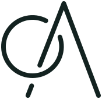
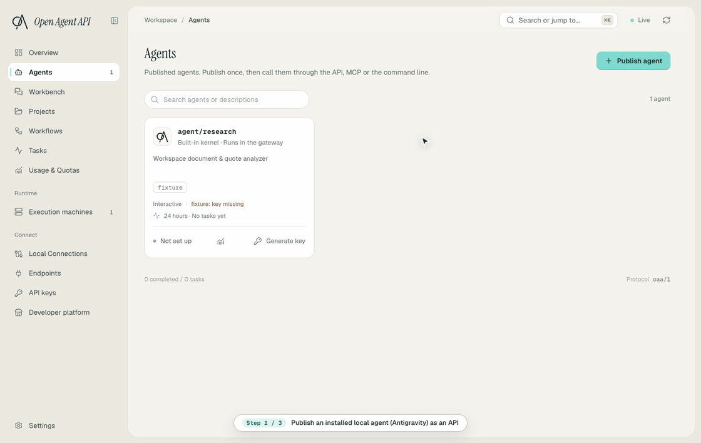
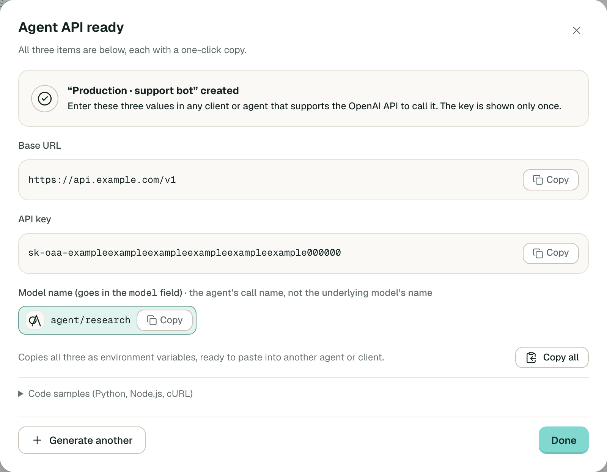

<p align="center">
  <picture>
    <source media="(prefers-color-scheme: dark)" srcset="docs/brand/oaa-mark-inverse.svg" />
    
  </picture>
</p>

<h1 align="center">Open Agent API</h1>

<p align="center">
  <strong>Turn agents into an API.</strong><br />
  You call an agent, not a model: one with its own tools, skills, and permissions. One call is one task.
</p>

<p align="center">
  English · <a href="README.zh-CN.md">简体中文</a>
</p>

<p align="center">
  <a href="LICENSE"></a>
  <a href="package.json"></a>
</p>
<!-- Add a CI badge once the repository is public; the same goes for dynamic badges such as stars. Do not add badges that need repository data before then. -->

<p align="center">
  <picture>
    <source media="(prefers-color-scheme: dark)" srcset="docs/assets/hero-dark-en.png" />
    
  </picture>
</p>

<p align="center">
  
  <br />
  <sub>Recorded for real: the call goes to the Antigravity agent on this machine. Actual time 6.5 s; the wait is sped up.</sub>
</p>

## Thirty seconds

Change one line of Base URL in an existing app, and it gains an agent that does the work and stops to wait for your approval. Below is the same OpenAI SDK code with only `base_url` and `model` changed (and `api_key` replaced by a key created in the console).

```diff
 from openai import OpenAI

 client = OpenAI(
-    base_url="https://api.openai.com/v1",
-    api_key=OPENAI_API_KEY,
+    base_url="http://127.0.0.1:8787/v1",  # your Open Agent API
+    api_key="sk-oaa-…",                   # an API key created in the console
 )

 resp = client.chat.completions.create(
-    model="<some-model>",
+    model="agent/research",               # the agent's call name
     messages=[{"role": "user", "content": "Compare these three quotes on lead time and total price"}],
 )
 print(resp.choices[0].message.content)
```

The same in Node.js:

```diff
 import OpenAI from 'openai';

 const client = new OpenAI({
-  baseURL: 'https://api.openai.com/v1',
-  apiKey: process.env.OPENAI_API_KEY,
+  baseURL: 'http://127.0.0.1:8787/v1', // your Open Agent API
+  apiKey: process.env.OAA_API_KEY, // an API key created in the console
 });

 const resp = await client.chat.completions.create({
-  model: '<some-model>',
+  model: 'agent/research', // the agent's call name
   messages: [{ role: 'user', content: 'Compare these three quotes on lead time and total price' }],
 });
 console.log(resp.choices[0].message.content);
```

For the caller there are only two things: a Base URL and an API key. `model` holds the agent's call name, not the name of an underlying model; which model runs behind it is declared by the publisher when the agent is published. The Anthropic and Gemini SDKs also only need the service address and key changed; see [Protocols and SDKs](#protocols-and-sdks) below.

## Running in three minutes

The source route below requires Node.js 24.18 or newer on the 24 or 26 line (`engines` in `package.json` is `>=24.18.0 <27`); the installers and the Linux package bring their own Node.js (other routes: [Other ways to install](#other-ways-to-install)). No Redis or model keys are needed.

### Shortest path: one command

```sh
git clone https://github.com/jiangxingfan1-coder/Open-Agent-API.git
cd Open-Agent-API
npm ci --omit=optional --ignore-scripts
npm run build
npm run oaa -- quickstart
```

`quickstart` does five things and prints each one: initializes `.oaa/` (skipped if already done) → starts the gateway in the background, listening on `127.0.0.1` only (reused if already running) → publishes the offline sample agent `agent/sample` → creates a caller key stored in the private file `.oaa/keys/quickstart.key` (reused if it still works; the key itself is not printed) → makes one real call with that key and prints the answer. It ends with the Base URL, the `model`, a curl command you can paste and run, a minimal snippet for the official OpenAI SDK, and the next steps to connect your own agent: one line such as `oaa connect codex` for each of codex, claude, or agy that is installed; otherwise how to use a built-in agent with a model key. Running it again creates nothing new.

The sample agent is `examples/sample-agent.mjs` in the repository: it **calls no model, uses no network, and costs nothing**; its answer is generated by fixed rules and opens by saying it is the Open Agent API offline sample agent. It demonstrates steps, one tool call, and, when the task contains "approve", a pause for your approval (approve in the console, or with the caller key via `POST /v1/runs/{id}/actions/{action}`), after which the same task finishes.

The default port is 8787; if it is taken, `quickstart` reports `port_in_use` and you can pick another with `npm run oaa -- quickstart --port 18787` (the port is saved in `.oaa/config.json`; replace `8787` below accordingly). Stop the gateway with `npm run oaa -- stop`.

### Other ways to install

Every route ends with `oaa quickstart`. Shortest steps, limits and uninstall for each are in [docs/install.md](docs/install.md). The Linux package, `install.sh`, the npm tarball and the Docker image come with releases from 0.0.65 on; 0.0.64 has only the macOS and Windows installers.

- **macOS and Windows installers** (`.dmg`, `.zip`): download from the [Releases page](https://github.com/jiangxingfan1-coder/Open-Agent-API/releases). They bundle Node.js; they are not notarized or code-signed, so the first launch needs one extra click (steps in install.md).
- **Linux, x64 and arm64** (glibc 2.28+; no root, no Node.js needed):

  ```sh
  curl -fsSL https://github.com/jiangxingfan1-coder/Open-Agent-API/releases/latest/download/install.sh | sh
  oaa quickstart
  ```

  It verifies the download against the release's `SHA256SUMS` and installs under `~/.local`.
- **Docker** (from a checkout: `docker compose up --build -d`): the gateway is published on the host's `127.0.0.1:8787` only. The container has none of the agent CLIs installed on your host (no Codex, no Claude Code), so it fits built-in agents with your own model key, ACP / A2A remote agents, and execution nodes that connect in. CI builds the image and smoke-tests the container on every push; the images on `ghcr.io` (amd64 and arm64) are pushed when a release is published.
- **npm tarball** (needs Node.js 24.18 or newer on the 24 or 26 line): `npm install -g <URL of open-agent-api-<version>.tgz on the Releases page>`, then `oaa quickstart`. The package is `private`, not on the npm registry.

### Connect your own agent: `oaa connect`

`npm run oaa -- connect codex` (or `claude`, `agy`, or an ACP agent name listed by `oaa doctor`) does it in one step: checks that it is installed → enables it on this gateway (only this gateway's record; its own configuration and sign-in are untouched) → publishes it as `agent/codex` (skipped if already published) → checks that the quickstart key can call it → prints the `model` and a curl you can paste. connect **does not call** the agent: the first call uses its own sign-in and quota on this machine. If it is not installed, connect says to install and sign in to it, then run quickstart so the gateway sees it.

### Step by step

To publish an agent that does real work, you need Codex, Claude Code, Antigravity, or an ACP agent installed and signed in on this machine (`npm run oaa -- doctor` lists what it finds), or an API key for a model provider (to run a built-in agent). These are the steps behind `quickstart`:

```sh
npm run oaa -- init                 # writes .oaa/config.json and the admin key .oaa/admin.token
npm run oaa -- serve --detach       # starts in the background, prints {"url": …, "pid": …}; stop with npm run oaa -- stop
```

To run in the foreground use `npm start` (it holds the terminal; run the next commands in a second one).

1. **Open the console** at `http://127.0.0.1:8787` and select `.oaa/admin.token` in the connection settings. Keep this admin key private.
2. **Publish an agent** with "Publish agent" in the console. When you initialize from source or the command line (`oaa init`), discovered external agents are **disabled** and must be enabled under the console's "Execution machines" page; for an out-of-the-box start, the macOS desktop app enables the local agents it detects (codex, claude, agy, dsh) at launch, with the gateway listening only on the loopback address `127.0.0.1`. To keep an agent from being callable, disable it under "Execution machines" (the choice is kept in the local database). The toggle is stored only in this platform, does not change the external agent's own global configuration, and never extracts or modifies existing credentials. The command-line equivalent (`default` keeps the model configured in the external agent itself):

   ```sh
   npm run oaa -- publish-native --id agent/codex --engine codex --models default \
     --url http://127.0.0.1:8787 --token-file .oaa/admin.token
   ```

   You can also define a built-in agent in OAA-Lang or JSON; see [docs/language.md](docs/language.md) and [docs/operations.md](docs/operations.md) (this requires configuring a model provider yourself; the examples in the repository use placeholders).
3. **Create an API key** on the console's "API keys" page ("Generate key"). The result page shows the service address (Base URL), the API key (it looks like `sk-oaa-…` and is shown once), and the model name, each with a copy button. Create one key per calling application. The command-line equivalent (the key goes into a private file and is not printed):

   ```sh
   npm run oaa -- key create --name myapp --agent agent/codex \
     --url http://127.0.0.1:8787 --token-file .oaa/admin.token
   ```

   In the output, `token_file` is the file holding the key (by default `.oaa/keys/myapp.key`), `base_url` and `model` are the two values the SDK code above needs, and `try` is a curl command you can paste and run. The default scopes are invoke, read, and files; add `--approve` to let this key approve pending actions too.
4. **Make your first call**: put those three values into the Python or Node code above, or run the `try` command from the previous step. The command line can also submit a background task:

   ```sh
   npm run oaa -- invoke agent/codex --input 'Your task' \
     --url http://127.0.0.1:8787 --token-file .oaa/keys/myapp.key
   npm run oaa -- wait <the id printed above> --url http://127.0.0.1:8787 --token-file .oaa/keys/myapp.key
   ```

   `invoke` returns the task `id` immediately (status `queued`), `wait` waits for it to finish, and `output` reads its text. To avoid repeating `--url` and `--token-file`, set `OAA_GATEWAY_URL` and `OAA_TOKEN_FILE`. The call shows up in the console's task list.

Model aliases are declared by the publisher and do not guarantee that the upstream account can access them.

### Common errors

| What you see | Cause and next step |
| --- | --- |
| HTTP 401 `unauthorized` | No key, or an invalid one. The OpenAI / Claude / Gemini SDKs send it as `Authorization: Bearer`, `x-api-key`, and `x-goog-api-key`; use the key from step 3 |
| HTTP 403 `scope_denied` | This key is not granted this `model`. The usual cause is a misspelled `model`: request `GET /v1/models` with the same key to see which agents it can call |
| HTTP 404 `agent_not_found` | The gateway has no such agent (you see this code with an admin key). Check `GET /v1/models` as well |
| HTTP 503 `model_unavailable` | The agent is published but nothing can run it: the external agent is not installed or not enabled under "Execution machines", or the built-in agent's model provider is unavailable (for example `OPENAI_API_KEY` is not set). `npm run oaa -- doctor` lists the agents found on this machine |
| CLI `gateway_unreachable`, SDK `Connection error` | The gateway is not running or the address is wrong: `npm run oaa -- serve --detach`, or check `--url` and `port` in `.oaa/config.json` |

### What you can see without installing any agent

The `agent/sample` that `quickstart` publishes exists for this: with it you can see steps and a tool call (the timeline and steps in the task inspector), a durable approval when the task contains "approve", and continuation with `previous_response_id` (the answer moves to turn 2). For cancellation, resume, and failure behaviour, `test/fixtures/acp-agent.mjs` in the repository is the ACP test double (source checkouts only), connected the same way as the sample agent: add `{"transport":"acp","command":"<absolute node path>","args":["<absolute repo path>/test/fixtures/acp-agent.mjs","stream"],"enabled":true}` under `localWorker.adapters` in `.oaa/config.json`, restart the gateway, then `publish-native --engine adapter/<name>`; with `MODE:permission` in the input the task stops for approval, and with `MODE:hang` it keeps running until you cancel it with `npm run oaa -- cancel <id>`.

There is also `npm run demo`: it runs the kernel in-process with a local deterministic model (no gateway) and writes `.oaa-demo/report.md`.

## How it differs from model relay platforms

Model relay platforms distribute model inference capacity; this distributes complete agents. It borrows the platform shape of that category (accounts, keys, quotas, usage, an admin console) but not its supply model: no subscription pooling, no relaying of login sessions.

| | Model relay platforms | Open Agent API |
| --- | --- | --- |
| What is distributed | Model inference capacity | Agents: complete execution units with their own tools, skills, model routes, and permissions |
| What goes in `model` | A model name | An agent's call name, such as `agent/research` |
| What one call is | One model completion | One task: a multi-turn tool loop that can be approved, interrupted, and resumed, and that produces artifacts |

## Which agents can be connected

The called agent can be one defined in OAA-Lang or JSON and run by the built-in kernel, or an external agent installed on the machine. External agents bring their own tools, models, and permissions; the gateway turns them into an API and handles dispatch, approvals, checkpoints, and recovery.

| Connection | Streamed text | Approvals while running | Caller-tool bridging | Image input | Notes |
| --- | --- | --- | --- | --- | --- |
| Built-in kernel (OAA-Lang / JSON) | Per token | Yes; the run parks when a tool is declared to need approval | Yes | If the model route takes images | Uses the model provider you configure; multiple routes and failover |
| Codex | Per token | Yes | No | Natively (not run against the real agent) | A dedicated app-server integration with session resume |
| Claude Code | Per message | Yes | No | Natively (not run against the real agent) | The official Agent SDK, using a separately installed CLI and its own configuration |
| Antigravity | Per token | No: if the agent itself refuses, the task fails with `permission_denied` | No | As a file in the workspace | `stream-json` integration; the only external agent with a real-agent validation so far |
| ACP agents | Per token | Yes (only `allow_once` is chosen) | Yes | As an ACP image block when the agent declares it, else as a file | [Agent Client Protocol](https://agentclientprotocol.com); presets for common ACP agents are built in |
| Your own adapter (`oaa/1` stdio, `oaa/1-stream`, HTTP) | Depends on the form | Yes for `oaa/1-stream` | No | stdio: as a file; HTTP: no | Wrap an agent that has no ready-made integration |
| A2A remote agents | Yes (SSE) | Not bridged: `input-required` ends the turn with the agent's question | No | No | Continues the same task through `contextId` |

This table is a summary. Cancellation, resume, usage, and artifacts per connection and per protocol are in [docs/adapters.md](docs/adapters.md#agentapi-conversion-contract-2026-11-08); every agent's `conversion` field gives the same profile. A few notes:

- The difference is in depth of interaction, not in whether an agent can be connected. All four kinds of connection can publish an agent as an Agent API.
- An external agent's permissions are inherited. The gateway does not sandbox it: one call can read or modify anything the host runtime allows. The caller's key needs the `host` execution level to call an external agent; read [docs/deploy-public.md](docs/deploy-public.md) before distributing keys.
- When publishing an external agent you can set permission requests to be approved automatically (`--approvals auto`). That lets the caller drive it with your privileges on this machine, so open it only to callers you trust; the risks are described in [docs/protocol.md](docs/protocol.md#approval-policy-for-external-agents-approval-policy-v1).
- When the caller is itself an agent (Cursor, Cline, Claude Code, and so on), the `tools` it sends are by default (mode `auto`) handed to the agent when it can take them over (the calls come back as standard `tool_calls` to run, and the same task continues once results return); an agent that cannot keeps using its own tools, as before. `managed`, `bridge`, `reject` and `auto` can be chosen explicitly, and `clientTools.default` changes the default. See [docs/harness.md](docs/harness.md).
- An image sent to an agent that cannot use images is refused before a run exists, and `GET /v1/models` shows `image_input` for each agent. How each agent receives images, the limits, and the fact that the gateway does not fetch remote image URLs by default: [docs/images.md](docs/images.md).
- Callers can also discover and call agents through the MCP entry (`npm run oaa -- mcp --url … --token-file …`, or `npm run oaa -- integration` to generate the launch config; see [docs/operations.md](docs/operations.md)). For safety the MCP entry deliberately offers no tool for approving.

## Protocols and SDKs

| Entry | How it was checked with the official SDKs |
| --- | --- |
| OpenAI Chat Completions and Responses (streaming and not) | Regression tests live in the repository, using the official `openai` Node SDK against an in-process gateway, without listening on a port; the compatibility lab below also runs the Python and Node SDKs over a socket |
| Claude Messages | Also regression tests, using the official `@anthropic-ai/sdk` 1.3.0; the lab runs the Python SDK and a newer Node SDK |
| Gemini `generateContent` / `streamGenerateContent` | The lab runs `google-genai` (Python) and `@google/genai` (Node); regression tests assert the wire format. An earlier one-off check with a temporarily installed `@google/genai` 3.2.0 is the probe script [examples/gemini-sdk-probe.mjs](examples/gemini-sdk-probe.mjs) |
| The native `oaa/1` protocol, UAP/1, MCP | See [docs/protocol.md](docs/protocol.md) |

Beyond those regression tests, a compatibility lab (`npm run compat`, also run on every push and weekly in CI) runs the real packages against an isolated, offline gateway whose agent is a sample or a deterministic fixture, not a real one: the official `openai`, `anthropic` and `google-genai` Python SDKs and their Node counterparts, the Vercel AI SDK, LangChain, LiteLLM, the OpenAI Agents SDK and LlamaIndex. Open WebUI, LibreChat, Chatbox, Cherry Studio, LobeChat, NextChat, Dify, n8n, Continue, Cline / Roo Code and Zed cannot be installed in a test run, so the request each one sends was read from its source and is replayed against the gateway; Cursor (closed source) is unverified. Which is which, how to configure each client, and how unsupported or ignored parameters are treated: [docs/compatibility.md](docs/compatibility.md).

Any client that speaks one of these protocols works with just a Base URL and an API key; the `Authorization: Bearer`, `x-api-key`, and `x-goog-api-key` headers are all accepted. Unsupported input fails loudly instead of degrading silently: audio and other inline binary parts, for example, are always rejected with 400 `unsupported_content`; upload the file with `POST /v1/files` and reference it instead. Parameters that only influence sampling (`temperature`, `top_k`, ...) are accepted and ignored, and the response header `X-OAA-Ignored-Params` says which. See [docs/protocol.md](docs/protocol.md#compatibility-endpoint-parameters-errors-and-finish-reasons-060).

Two things a caller can ask for beyond text: **images** on every entry ([docs/images.md](docs/images.md)), and **JSON that is guaranteed to fit a schema** (`response_format`, `text.format`, `responseSchema`, `output_config.format`): the gateway validates the answer, sends a wrong one back to the agent for correction, and otherwise fails the run with `structured_output_invalid` instead of returning text that only looks like JSON ([docs/structured-output.md](docs/structured-output.md)).

## The control plane: keeping a person in the loop

Agents read files, run commands, and write code. The gateway makes "when a person steps in" a durable state rather than a one-off pop-up.

- **Approvals**: when an agent wants to do something that needs approval, the task stops at "awaiting approval". You approve or reject it in the console, in a terminal (`oaa approvals`, `oaa approve`, `oaa deny`), or through the API with a key that has the `approve` scope, and the same task carries on. An approval is a durable suspension point, not a one-off pop-up.
- **Callbacks**: run events (completed, failed, awaiting approval, ...) can be pushed to an HTTPS endpoint of yours, signed and retried (`oaa webhook add`), so a caller does not have to poll and approval requests can go into your chat tool or your own system. See [docs/webhooks.md](docs/webhooks.md).
- **Interrupt and resume**: a task can be cancelled at any time, and an interrupted task can be resumed. For an external write whose outcome is unknown (a command cut off halfway, say), the outcome must be confirmed by a person before the task can resume.
- **Idempotency**: with an `Idempotency-Key` header, one key maps to one task; the same key with different input returns 409.
- **Task inspector**: every task's timeline, critical path, execution steps, approvals, and artifacts can be inspected, and its event stream replayed.

<p align="center">
  <picture>
    <source media="(prefers-color-scheme: dark)" srcset="docs/assets/inspector-dark-en.png" />
    
  </picture>
</p>

<p align="center">
  <picture>
    <source media="(prefers-color-scheme: dark)" srcset="docs/assets/runs-dark-en.png" />
    
  </picture>
</p>

After you create an API key in the console, the result page gives the caller everything it needs:

<p align="center">
  <picture>
    <source media="(prefers-color-scheme: dark)" srcset="docs/assets/api-key-dark-en.png" />
    
  </picture>
</p>

How to use the console is described in [docs/console.md](docs/console.md).

## Offer it as a developer platform

The gateway can be offered to developers as a platform: they register themselves, create their own API keys in a portal, and call the agents you list, billed in credits per task. Click "Enable" on the console's developer platform page (saved in the gateway's data, effective after a restart); on the same page you list agents, set prices, issue credits, and manage accounts. You can also add a `platform` block to the configuration file. When it is not enabled none of this exists, and the gateway behaves as before.

<p align="center">
  <picture>
    <source media="(prefers-color-scheme: dark)" srcset="docs/assets/portal-dark-en.png" />
    
  </picture>
</p>

By default developers can call only built-in agents. An operator can also list an external agent (Codex, Claude Code, an ACP agent) for platform accounts, one listing at a time, with a switch that is off by default: the agent then runs as the system user that runs the gateway, so read the security notes first. A per-task price is held when a task starts and released if the task does not complete, token charges never take a balance below zero, and an agent that reports no token usage can only be priced per task.

Credits are an accounting unit that the operator issues; the platform has no payment channel and sends no email. Billing rules, the API, and limits are in [docs/platform.md](docs/platform.md).

## Desktop app and command line

- **Command line**: `oaa --help` (from a checkout, `npm run oaa -- --help`) lists every subcommand, including `quickstart`, `connect`, `init`, `serve`, `stop`, `status`, `doctor`, `key create`, `publish`, `publish-native`, `invoke`, `wait`, `approvals`, `approve`, `deny`, `webhook`, `verify`, `cancel`, `resume`, `nodes`, and `mcp`; `check` and `fmt` check and format OAA-Lang source, and compiling, checking, and formatting never call a model. `oaa status` shows how the gateway and its agents are doing, and `oaa verify` runs a self-check against a real agent on your machine (it prints what it will do and starts nothing until you add `--confirm-live-cost`). Every command, grouped by task: [docs/cli.md](docs/cli.md).
- **macOS desktop app**: the source is in `desktop/macos`. It embeds the same console and adds a Dock badge and approval notifications; its menus and dialogs follow the system language, it reads its port from its own `config.json`, and it can run isolated from an installed copy (`OAA_DESKTOP_HOME`, `OAA_DESKTOP_PORT`, see [install.md](docs/install.md#macos)). Build it from source with `npm run package:mac` (`npm run package:win` for Windows). Installers are on the Releases page ([install routes](docs/install.md)); the macOS and Windows ones are not notarized or code-signed, and neither is one you build yourself. The changes of this version were checked by hand once, on an Apple silicon Mac in an isolated run; what that did and did not cover is in [docs/releasing.md](docs/releasing.md#manual-checks-before-publishing).

## Documentation

The full index, organized by what you want to do, is in [docs/README.md](docs/README.md). Common entry points: [Installing](docs/install.md), [Command line](docs/cli.md), [Operations](docs/operations.md), [Protocol](docs/protocol.md), [Compatibility with SDKs and clients](docs/compatibility.md), [Structured output](docs/structured-output.md), [Image input](docs/images.md), [Webhooks](docs/webhooks.md), [Two-layer harness](docs/harness.md), [OAA-Lang](docs/language.md), [Connecting external agents](docs/adapters.md), [Console](docs/console.md), [Windows](docs/windows.md), [Public deployment](docs/deploy-public.md), [Security model](docs/security-model.md), [Developer platform](docs/platform.md), [Architecture](docs/architecture.md), [Evidence](docs/evidence.md), [Engineering conventions](docs/engineering.md), [Changelog](CHANGELOG.md) and [Roadmap](ROADMAP.md). Every document is also available in Chinese under [`docs/zh-CN/`](docs/zh-CN/README.md).

## Status and limits

This lists what has been done and what has not; it is not a roadmap. The detail, with dates, is in [docs/evidence.md](docs/evidence.md).

**Tests and CI**

- The project has 1,021 tests written with `node:test`. `npm run verify` runs the type check, the format check, and the full suite; `npm run test:offline` runs only the tests that do not listen on a port.
- CI runs the whole suite on Ubuntu and macOS with Node 24 and Node 26, and on Windows (Node 24; tests that only make sense on POSIX skip with a stated reason). It also builds the Docker image and smoke-tests the container, and runs the compatibility lab.
- The tests use a local deterministic model, local protocol servers, and stand-in agents. They do **not** prove compatibility with real providers, real agents, real cross-machine performance, or account access. The streaming, fairness, and paired benchmarks are local measurements; their conditions and limits are in [docs/operations.md](docs/operations.md) and [docs/architecture.md](docs/architecture.md).
- The compatibility lab runs the official SDKs and several frameworks against a gateway whose agent is a sample or a fixture, and replays the recorded requests of chat clients. A replay shows that a client's request is accepted and answered in a form it parses, not that the application works. Cursor is unverified. See [docs/compatibility.md](docs/compatibility.md).

**Validation with real agents**

- Only Antigravity has been validated for real: one end-to-end run of 12 real calls (2026-11-13) passed OpenAI Chat (non-streaming and streaming), Responses continuation, Claude Messages, Gemini `generateContent`, cancellation, and concurrency. That validated one local route and one engine; approvals and caller-tool bridging are not supported under Antigravity. The script is [examples/live-agents-acceptance.ts](examples/live-agents-acceptance.ts), and `oaa verify` runs the same scenarios on your machine.
- Codex, Claude Code, built-in agents with a real model provider, and public deployment have **not** had this kind of end-to-end validation. Image delivery to Codex and Claude Code is implemented from the vendors' documentation and has not been run against the real agents. [docs/evidence.md](docs/evidence.md) records an earlier manual test session: one managed call to Codex passed and Claude Code failed because its CLI was not logged in; the code has changed since, and it was not re-run. If you have Codex or Claude Code installed, `oaa verify` and the [agent verification report](https://github.com/jiangxingfan1-coder/Open-Agent-API/issues/new/choose) template are the most useful thing you can send us.

**Installing and platforms**

- The Docker image is built and smoke-tested in CI (amd64). The Linux packages, `install.sh`, the npm tarball, and the multi-architecture image have not yet been through the release workflow; the first release that includes them is their first run.
- Windows: the full test suite passes in CI, but the behavior has not been tried with real Codex, Claude Code, or Antigravity on Windows, and there is no sandbox there.
- The macOS desktop app was checked by hand once, by the project owner, on an Apple silicon Mac in an isolated run: it opens already connected, shows the first-launch note once, stays connected after a reload, shows the right version, and its menus and dialogs follow the system language. Not checked: the messages for a port that is in use, switching the language in both directions, restarting with the same data folder, recovering a gateway left by a crashed app, the Intel package, the normal installation on the default port, and the bilingual messages of the Windows launcher.
- The macOS and Windows installers are not notarized or code-signed.

**Developer platform**

- A single gateway with SQLite: no multiple instances, no Postgres, and no settlement across multiple publishers.
- No real payment channel: credits are not connected to payments; there is no email verification and no emailed password reset (reset codes are passed to the developer by the operator through another channel). Rate-limit counters live in process memory and reset on restart.
- Account keys can call only built-in agents unless the operator turns on `host_execution` for a listing, which makes that external agent run as the gateway's system user. That path is tested with the offline sample agent; the success path of billing with a real external agent has not been seen.
- It has not been validated on a real public deployment.

**Other**

- A requested JSON schema is enforced by the gateway, not passed to the model provider's own structured-output feature, and a forced tool choice (`tool_choice` required) is not supported. Audio input is not supported.
- External agents may not report token usage. In that case only the per-task price applies; reported token counts are not cost estimates, and token limits are not advertised as enforceable spending caps.
- Webhooks have been tested against local receivers only, not a public HTTPS endpoint.
- What the gateway does not defend against (for example: no email verification on sign-up, and login failure counters kept in memory) is in [docs/security-model.md](docs/security-model.md).
- No scanning of the home directory for keys, no training of base models, no subscription pooling, and no hidden credential relaying.

## Contributing, security, and conduct

Issues and pull requests are welcome; see [CONTRIBUTING.md](CONTRIBUTING.md). To report a security vulnerability, read [SECURITY.md](SECURITY.md) and do not file it publicly. Taking part means agreeing to follow the [CODE_OF_CONDUCT.md](CODE_OF_CONDUCT.md).

## Licenses and attribution

Open Agent API is licensed under the [Apache License 2.0](LICENSE); the copyright notice and the attributions that must be preserved are in [NOTICE](NOTICE). Third-party licenses and attribution are in [THIRD_PARTY_NOTICES.md](THIRD_PARTY_NOTICES.md). Note that the runtime dependency `@anthropic-ai/claude-agent-sdk` is proprietary software from Anthropic: you install it yourself from npm, it is governed by its own terms, and this project's license does not cover it (see THIRD_PARTY_NOTICES.md).

The metadata for the ACP agent presets, and some agent icons, are adapted from [Open Design](https://github.com/nexu-io/open-design) (Apache-2.0, Copyright 2026 Open Design contributors); the exact scope and the license text are in [NOTICE](NOTICE) and [licenses/OpenDesign-APACHE-2.0.txt](licenses/OpenDesign-APACHE-2.0.txt). The fonts used by the interface (Geist, Geist Mono, Instrument Serif, Noto Serif SC) are licensed under SIL OFL 1.1; the license texts are in the [licenses/](licenses/) directory.
