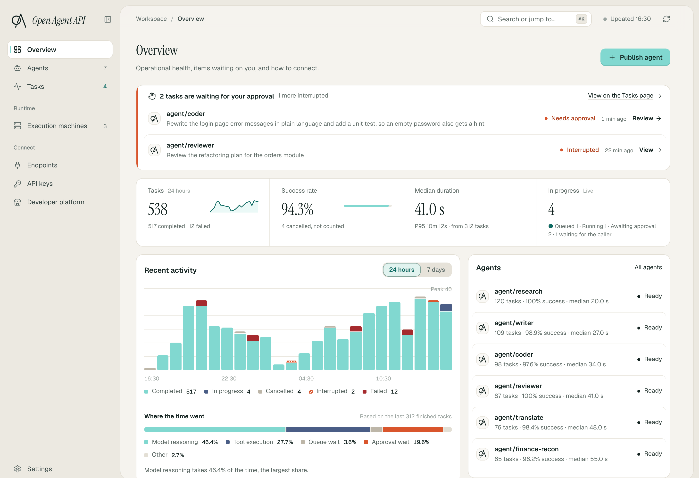
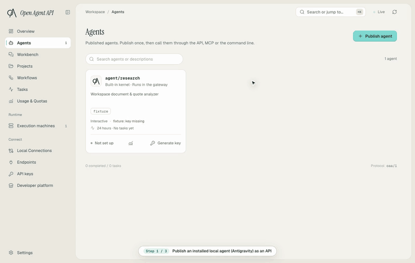
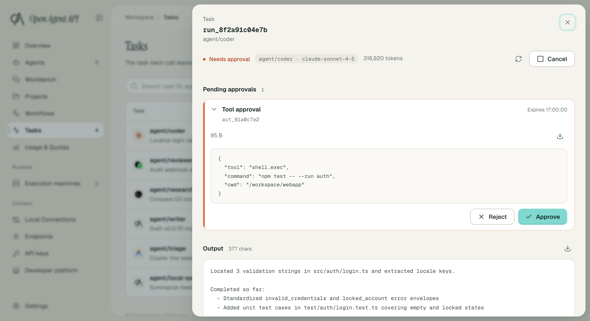
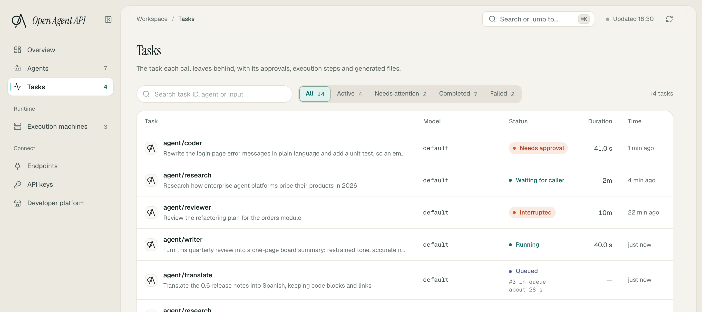
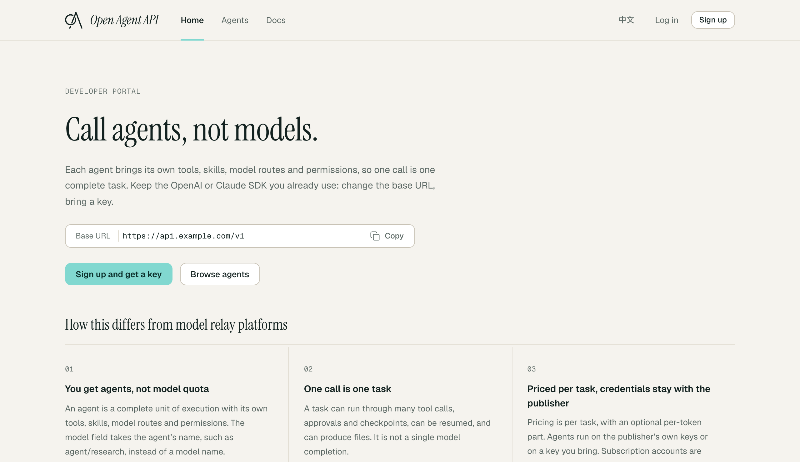

<p align="center">
  <picture>
    <source media="(prefers-color-scheme: dark)" srcset="docs/brand/oaa-mark-inverse.svg" />
    
  </picture>
</p>

<h1 align="center">Open Agent API</h1>

<p align="center">
  <strong>Turn agents into an API.</strong><br />
  You call an agent, not a model: one with its own tools, skills, and permissions. One call is one task.
</p>

<p align="center">
  English · <a href="README.zh-CN.md">简体中文</a>
</p>

<p align="center">
  <a href="LICENSE"></a>
  <a href="package.json"></a>
  <a href="https://github.com/jiangxingfan1-coder/Open-Agent-API/actions/workflows/ci.yml"></a>
</p>

<p align="center">
  <picture>
    <source media="(prefers-color-scheme: dark)" srcset="docs/assets/hero-dark-en.png" />
    
  </picture>
</p>

## Live Walkthrough: Publish → Key → SDK Call

<p align="center">
  
  <br />
  <sub>Light-mode end-to-end flow: 1. Publish local agent (<code>agent/antigravity</code>) → 2. Issue a scoped <code>sk-oaa-…</code> key → 3. Stream an official OpenAI SDK call and inspect the completed timeline · See the <a href="docs/quickstart.md">Five-Minute Quickstart</a></sub>
</p>

## Thirty seconds

Skip the rewrite. Swap two lines in your existing OpenAI, Anthropic, or Gemini SDK client—point `base_url` at the gateway and put an agent ID in `model`—and your app calls a full agent that uses its own tools, remembers across turns, and stops when a sensitive action needs your sign-off.

```diff
 from openai import OpenAI

 client = OpenAI(
-    base_url="https://api.openai.com/v1",
-    api_key=OPENAI_API_KEY,
+    base_url="http://127.0.0.1:8787/v1",  # your Open Agent API
+    api_key="sk-oaa-…",                   # an API key created in the console
 )

 resp = client.chat.completions.create(
-    model="<some-model>",
+    model="agent/research",               # the agent's call name
     messages=[{"role": "user", "content": "Compare these three quotes on lead time and total price"}],
 )
 print(resp.choices[0].message.content)
```

The same in Node.js:

```diff
 import OpenAI from 'openai';

 const client = new OpenAI({
-  baseURL: 'https://api.openai.com/v1',
-  apiKey: process.env.OPENAI_API_KEY,
+  baseURL: 'http://127.0.0.1:8787/v1', // your Open Agent API
+  apiKey: process.env.OAA_API_KEY, // an API key created in the console
 });

 const resp = await client.chat.completions.create({
-  model: '<some-model>',
+  model: 'agent/research', // the agent's call name
   messages: [{ role: 'user', content: 'Compare these three quotes on lead time and total price' }],
 });
 console.log(resp.choices[0].message.content);
```

From the caller's side, there are only a Base URL and an API key. `model` names the agent, not a raw model; which model runs behind it, what tools it gets, and what requires approval stay on the gateway side. See [Protocols and SDKs](#protocols-and-sdks) for Anthropic, Gemini, MCP, and other clients.

## Running in three minutes

The source route below requires Node.js 24.18 or newer on the 24 or 26 line (`engines` in `package.json` is `>=24.18.0 <27`); the installers and the Linux package bring their own Node.js (other routes: [Other ways to install](#other-ways-to-install)). No Redis or model keys are needed.

### Shortest path: one command

```sh
git clone https://github.com/jiangxingfan1-coder/Open-Agent-API.git
cd Open-Agent-API
npm ci --omit=optional --ignore-scripts
npm run build
npm run oaa -- quickstart
```

`quickstart` does five things and prints each one: initializes `.oaa/` (skipped if already done) → starts the gateway in the background, listening on `127.0.0.1` only (reused if already running) → publishes the offline sample agent `agent/sample` → creates a caller key stored in the private file `.oaa/keys/quickstart.key` (reused if it still works; the key itself is not printed) → makes one real call with that key and prints the answer. It ends with the Base URL, the `model`, a curl command you can paste and run, a minimal snippet for the official OpenAI SDK, and the next steps to connect your own agent: one line such as `oaa connect codex` for each of codex, claude, or agy that is installed; otherwise how to use a built-in agent with a model key. Running it again creates nothing new.

The sample agent is `examples/sample-agent.mjs` in the repository: it **calls no model, uses no network, and costs nothing**; its answer is generated by fixed rules and opens by saying it is the Open Agent API offline sample agent. It demonstrates steps, one tool call, and, when the task contains "approve", a pause for your approval (approve in the console, or with the caller key via `POST /v1/runs/{id}/actions/{action}`), after which the same task finishes.

The default port is 8787; if it is taken, `quickstart` reports `port_in_use` and you can pick another with `npm run oaa -- quickstart --port 18787` (the port is saved in `.oaa/config.json`; replace `8787` below accordingly). Stop the gateway with `npm run oaa -- stop`.

### Other ways to install

Every route starts up cleanly with `oaa quickstart`; exact install and uninstall steps live in [docs/install.md](docs/install.md). Since `0.0.65`, the [Releases page](https://github.com/jiangxingfan1-coder/Open-Agent-API/releases) carries installers for every desktop target alongside `install.sh`, the npm tarball, and container builds.

- **Cross-platform desktop & CLI bundles** (macOS `arm64`/`x64` `.dmg`, Windows `x64` `.zip`, Linux `x64`/`arm64` `.tar.gz`): bundle their own Node.js 24 runtime. They are not Apple-notarized or commercially signed yet, so the OS asks for one extra click on first launch (see install.md).
- **Linux one-liner** (`x64` and `arm64`, glibc 2.28+, no root and no Node.js needed):

  ```sh
  curl -fsSL https://github.com/jiangxingfan1-coder/Open-Agent-API/releases/latest/download/install.sh | sh
  oaa quickstart
  ```

  Verifies downloads against the release's `SHA256SUMS` and installs under `~/.local`.
- **Docker** (`docker compose up --build -d` from a checkout): binds only to host `127.0.0.1:8787`. Because the container does not ship your host agent CLIs, use it for built-in agents with model keys, remote ACP / A2A agents, or external workers connecting in. CI builds and smoke-tests the `amd64` image on every push; multi-arch `ghcr.io` images push on published releases.
- **npm tarball** (requires Node.js 24.18+ on line 24 or 26): `npm install -g <URL of open-agent-api-<version>.tgz on Releases>`, then `oaa quickstart`. The package stays `private` and is not on npmjs.org.

### Connect your own agent: `oaa connect`

`npm run oaa -- connect codex` (or `claude`, `agy`, or an ACP agent name listed by `oaa doctor`) does it in one step: checks that it is installed → enables it on this gateway (only this gateway's record; its own configuration and sign-in are untouched) → publishes it as `agent/codex` (skipped if already published) → checks that the quickstart key can call it → prints the `model` and a curl you can paste. connect **does not call** the agent: the first call uses its own sign-in and quota on this machine. If it is not installed, connect says to install and sign in to it, then run quickstart so the gateway sees it.

### Give the built-in agent a model: `oaa connect <preset>`

The built-in agent (the gateway's own agent loop) needs a model provider. `oaa connect ollama` (a local model, no key) or `oaa connect deepseek --key-file ~/.config/deepseek.key` (also `openai`, `anthropic`, `gemini-api`, `openrouter`, `lmstudio`, `openai-compatible` and others) writes the provider into `.oaa/config.json`, restarts a gateway that this data directory started, publishes `agent/assistant` (a general assistant with the workspace file tools), checks the quickstart key and prints a curl. A key is never typed on the command line: `--key-env` names a variable and `--key-file` points to a file. It does not call a model unless you add `--test` (loopback endpoints only), and `oaa models` lists the configured providers and whether their keys resolve. The presets were taken from each service's documentation and have only been run against fake services. See [docs/models.md](docs/models.md).

### Step by step

To publish an agent that does real work, you need Codex, Claude Code, Antigravity, or an ACP agent installed and signed in on this machine (`npm run oaa -- doctor` lists what it finds), or an API key for a model provider (to run a built-in agent). These are the steps behind `quickstart`:

```sh
npm run oaa -- init                 # writes .oaa/config.json and the admin key .oaa/admin.token
npm run oaa -- serve --detach       # starts in the background, prints {"url": …, "pid": …}; stop with npm run oaa -- stop
```

To run in the foreground use `npm start` (it holds the terminal; run the next commands in a second one).

1. **Open the console** at `http://127.0.0.1:8787` and select `.oaa/admin.token` in the connection settings. Keep this admin key private.
2. **Publish an agent** using "Publish agent" in the console. From a source checkout (`oaa init`), discovered CLI agents start disabled until you toggle them on under **Execution machines**; the unified desktop app enables detected local engines (`codex`, `claude`, `agy`, `dsh`) automatically on first launch while binding only to `127.0.0.1`. Preferences stay local in the gateway's database—it never touches an external tool's global config or extracts credentials—and you can disable any engine at any time. CLI equivalent (`default` inherits the CLI's own configured model):

   ```sh
   npm run oaa -- publish-native --id agent/codex --engine codex --models default \
     --url http://127.0.0.1:8787 --token-file .oaa/admin.token
   ```

   You can also define a built-in agent in OAA-Lang or JSON; see [docs/language.md](docs/language.md) and [docs/operations.md](docs/operations.md) (this needs a model provider: `oaa connect <preset>` above sets one up, and the definition templates in `examples/` use placeholders).
3. **Create an API key** on the console's "API keys" page ("Generate key"). The result page shows the service address (Base URL), the API key (it looks like `sk-oaa-…` and is shown once), and the model name, each with a copy button. Create one key per calling application. The command-line equivalent (the key goes into a private file and is not printed):

   ```sh
   npm run oaa -- key create --name myapp --agent agent/codex \
     --url http://127.0.0.1:8787 --token-file .oaa/admin.token
   ```

   In the output, `token_file` is the file holding the key (by default `.oaa/keys/myapp.key`), `base_url` and `model` are the two values the SDK code above needs, and `try` is a curl command you can paste and run. The default scopes are invoke, read, and files; add `--approve` to let this key approve pending actions too.
4. **Make your first call**: put those three values into the Python or Node code above, or run the `try` command from the previous step. The command line can also submit a background task:

   ```sh
   npm run oaa -- invoke agent/codex --input 'Your task' \
     --url http://127.0.0.1:8787 --token-file .oaa/keys/myapp.key
   npm run oaa -- wait <the id printed above> --url http://127.0.0.1:8787 --token-file .oaa/keys/myapp.key
   ```

   `invoke` returns the task `id` immediately (status `queued`), `wait` waits for it to finish, and `output` reads its text. To avoid repeating `--url` and `--token-file`, set `OAA_GATEWAY_URL` and `OAA_TOKEN_FILE`. The call shows up in the console's task list.

Model aliases are declared by the publisher and do not guarantee that the upstream account can access them.

### Common errors

| What you see | Cause and next step |
| --- | --- |
| HTTP 401 `unauthorized` | No key, or an invalid one. The OpenAI / Claude / Gemini SDKs send it as `Authorization: Bearer`, `x-api-key`, and `x-goog-api-key`; use the key from step 3 |
| HTTP 403 `scope_denied` | This key is not granted this `model`. The usual cause is a misspelled `model`: request `GET /v1/models` with the same key to see which agents it can call |
| HTTP 404 `agent_not_found` | The gateway has no such agent (you see this code with an admin key). Check `GET /v1/models` as well |
| HTTP 503 `model_unavailable` | The agent is published but nothing can run it: the external agent is not installed or not enabled under "Execution machines", or the built-in agent's model provider is unavailable (for example `OPENAI_API_KEY` is not set). `npm run oaa -- doctor` lists the agents found on this machine |
| CLI `gateway_unreachable`, SDK `Connection error` | The gateway is not running or the address is wrong: `npm run oaa -- serve --detach`, or check `--url` and `port` in `.oaa/config.json` |

### What you can see without installing any agent

The `agent/sample` that `quickstart` publishes exists for this: with it you can see steps and a tool call (the timeline and steps in the task inspector), and a durable approval when the task contains "approve". It cannot continue a session (a `previous_response_id` call is refused with `native_resume_unsupported`, because its ACP process declares neither `session/load` nor `session/resume`), and a cancel ends its run `incomplete` rather than `cancelled`. For continuation, cancellation, resume, and failure behaviour, `test/fixtures/acp-agent.mjs` in the repository is the ACP test double (source checkouts only), connected the same way as the sample agent: add `{"transport":"acp","command":"<absolute node path>","args":["<absolute repo path>/test/fixtures/acp-agent.mjs","stream"],"enabled":true}` under `localWorker.adapters` in `.oaa/config.json`, restart the gateway, then `publish-native --engine adapter/<name>`; with `MODE:permission` in the input the task stops for approval, and with `MODE:hang` it keeps running until you cancel it with `npm run oaa -- cancel <id>`.

There is also `npm run demo`: it runs the kernel in-process with a local deterministic model (no gateway) and writes `.oaa-demo/report.md`.

## How it differs from model relay platforms

Model relay platforms distribute model inference capacity; this distributes complete agents. It borrows the platform shape of that category (accounts, keys, quotas, usage, an admin console) but not its supply model: no subscription pooling, no relaying of login sessions.

| | Model relay platforms | Open Agent API |
| --- | --- | --- |
| What is distributed | Model inference capacity | Agents: complete execution units with their own tools, skills, model routes, and permissions |
| What goes in `model` | A model name | An agent's call name, such as `agent/research` |
| What one call is | One model completion | One task: a multi-turn tool loop that can be approved, interrupted, and resumed, and that produces artifacts |

## Which agents can be connected

You can call agents defined in OAA-Lang or JSON running on the built-in kernel, or local CLI agents already installed on your machine. External agents keep their own tools, model config, and sign-in; the gateway wraps them into one API and takes over queuing, durable approvals, checkpoints, and crash recovery.

| Connection | Streamed text | Approvals while running | Caller-tool bridging | Image input | Notes |
| --- | --- | --- | --- | --- | --- |
| Built-in kernel (OAA-Lang / JSON) | Per token | Yes; parks on tools needing approval | Yes | When the model route accepts images | Multi-route failover, OAA-Lang 2.5, cron and webhook triggers |
| Codex CLI | Per token | Yes | Yes (`oaa-caller` MCP + elicitation auto-allow) | Protocol items implemented from docs (not live-tested with images) | App-server transport with `thread/resume`, cooperative `turn/interrupt`, and tool-free planning |
| Claude Code | Per token (deduplicated partial stream) | Yes | Yes (`oaa-caller` MCP) | Image blocks implemented from docs (not live-tested) | Official Agent SDK (proprietary package installed separately) using the local CLI sign-in |
| Antigravity | Per token | Via `agy acp`; legacy headless denials remain failures | Yes on both native headless and `agy acp` | Agent-declared via ACP; else workspace files | Live model discovery and capability-gated transport selection |
| ACP agents | Per token | Yes (`allow_once`) | Yes | ACP image block if declared, else workspace file | [Agent Client Protocol](https://agentclientprotocol.com); built-in presets for `qoder`, `opencode-acp`, `grok-build-acp`, `deepseek-harness`, etc. |
| Custom adapter (`oaa/1` / HTTP) | Depends on mode | Yes on `oaa/1-stream` | No | stdio: workspace file; HTTP: no | Lightweight wrapper for any bespoke agent binary |
| A2A remote agents | Yes (SSE) | Not bridged (`input-required` ends turn with question) | No | No | Continues the same task via `contextId` |

The full per-protocol capability matrix lives in [docs/adapters.md](docs/adapters.md#agentapi-conversion-contract-2026-11-08) and is exposed on every agent's `conversion` field:

- The gap between paths is **interaction depth** (`basic`, `streaming`, `interactive`), not whether an agent can be served as an Agent API.
- External agents inherit host privileges unless sandboxed (POSIX); caller keys must carry `host` execution scope. Review [docs/deploy-public.md](docs/deploy-public.md) before exposing keys externally.
- Setting `--approvals auto` passes permission checks through without pausing—keep it restricted to trusted callers ([docs/protocol.md](docs/protocol.md#approval-policy-for-external-agents-approval-policy-v1)).
- When the caller is itself an agent (Cursor, Cline, Claude Code), `auto` mode delegates client-sent `tools` to bridging-capable backends as standard `tool_calls` and resumes the same task with tool results. You can also force `managed`, `bridge`, `reject`, or set `clientTools.default` ([docs/harness.md](docs/harness.md)).
- Image payloads sent to text-only agents are rejected before a run starts (`image_input` appears in `GET /v1/models`); remote image URLs are not fetched by default ([docs/images.md](docs/images.md)).
- Agents are also callable via MCP (`npm run oaa -- mcp` or configured in one click via the console's Connections view / `oaa integration`; see [docs/operations.md](docs/operations.md)). For safety, MCP deliberately exposes no approval tools.

## Protocols and SDKs

| Entry | How it was checked with the official SDKs |
| --- | --- |
| OpenAI Chat Completions and Responses (streaming and not) | Regression tests live in the repository, using the official `openai` Node SDK against an in-process gateway, without listening on a port; the compatibility lab below also runs the Python and Node SDKs over a socket |
| Claude Messages | Also regression tests, using the official `@anthropic-ai/sdk` 1.3.0; the lab runs the Python SDK and a newer Node SDK |
| Gemini `generateContent` / `streamGenerateContent` | The lab runs `google-genai` (Python) and `@google/genai` (Node); regression tests assert the wire format. An earlier one-off check with a temporarily installed `@google/genai` 3.2.0 is the probe script [examples/gemini-sdk-probe.mjs](examples/gemini-sdk-probe.mjs) |
| The native `oaa/1` protocol, UAP/1, MCP | See [docs/protocol.md](docs/protocol.md) |

Beyond those regression tests, a compatibility lab (`npm run compat`, also run on every push and weekly in CI) runs the real packages against an isolated, offline gateway whose agent is a sample or a deterministic fixture, not a real one: the official `openai`, `anthropic` and `google-genai` Python SDKs and their Node counterparts, the Vercel AI SDK, LangChain, LiteLLM, the OpenAI Agents SDK and LlamaIndex. Open WebUI, LibreChat, Chatbox, Cherry Studio, LobeChat, NextChat, Dify, n8n, Continue, Cline / Roo Code and Zed cannot be installed in a test run, so the request each one sends was read from its source and is replayed against the gateway; Cursor (closed source) is unverified. Which is which, how to configure each client, and how unsupported or ignored parameters are treated: [docs/compatibility.md](docs/compatibility.md).

Any client that speaks one of these protocols works with just a Base URL and an API key; the `Authorization: Bearer`, `x-api-key`, and `x-goog-api-key` headers are all accepted. Unsupported input fails loudly instead of degrading silently: audio and other inline binary parts, for example, are always rejected with 400 `unsupported_content`; upload the file with `POST /v1/files` and reference it instead. Parameters that only influence sampling (`temperature`, `top_k`, ...) are accepted and ignored, and the response header `X-OAA-Ignored-Params` says which. See [docs/protocol.md](docs/protocol.md#compatibility-endpoint-parameters-errors-and-finish-reasons-060).

**Progress in streams.** A streaming call can also show what the agent is doing: one short line per phase of the run (queued, a tool called, waiting for an approval) is sent in the protocol's own thinking shape, so a client that already shows a model's thinking shows it with no changes. It is on by default for Responses and Gemini, off for Chat Completions and Claude Messages; switch it per request with `X-OAA-Progress: reasoning | off` or per protocol with `streamProgress` in the configuration. The answer itself does not change. See [docs/progress.md](docs/progress.md).

Beyond plain text, callers can send **images** on every endpoint ([docs/images.md](docs/images.md)), force **`tool_choice`** (`none`, `auto`, `required`, or a named function—pushed straight to native drivers and bounded with correction turns on bridged agents, failing cleanly with `tool_choice_unmet` if unmet), and enforce **schema-validated JSON output** (`response_format`, `text.format`, `responseSchema`, `output_config.format`): pushed natively where supported (with zero-repair streaming passthrough) and repaired or failed cleanly (`structured_output_invalid`) everywhere else ([docs/structured-output.md](docs/structured-output.md)).

## Control plane, workbench, and workstation

Agents read files, shell out, and edit workspaces. Rather than burying those actions inside ephemeral HTTP calls, the gateway turns every run into a durable task you can pause, inspect, approve, and resume.

- **Approvals & quick tray panel**: Actions marked for review pause the run in `requires_action`. Approve or deny from the console, the inline `#workbench` card, the desktop tray quick-approval panel, the terminal (`oaa approvals`, `oaa approve`, `oaa deny`), or via API with an `approve`-scoped key.
- **Console `#workbench` & Local Connections**: Test multi-turn continuation (`previous_response_id`), paste screenshots, inspect caller-tool bridge rounds, and copy four-protocol SDK snippets right inside the console. Under Connections, configure Codex / OpenCode / DSH API providers or inject one-click MCP bridges for Claude Desktop, Cursor, Windsurf, and Claude Code backed by `0600` private key files.
- **Universal orchestration, durable memory & streaming artifacts**: Route `@fast`, `@best`, `@eco`, `recommend` (tool-free planner), or an explicit `orchestration.planner` across engines with automatic failover and OAA-Lang 2.5 pipelines. Persist cross-session context with SQLite FTS5 memory (`memory_read`, `memory_write`, `memory_search`), schedule cron or SHA-256-authenticated inbound webhook triggers, and stream signed artifacts (64 MiB default ceiling, configurable to 256 MiB).
- **Cancel, resume, idempotency & observability**: Cancel runs any time (writes cut off mid-flight require human confirmation of outcome before resuming); enforce single-execution via `Idempotency-Key` (409 on mismatched replay); push signed webhooks (`oaa webhook add`); and observe runs through timeline replay, W3C `traceparent`, Prometheus `/metrics`, and POSIX per-subject `srt` sandbox pools.

<p align="center">
  <picture>
    <source media="(prefers-color-scheme: dark)" srcset="docs/assets/inspector-dark-en.png" />
    
  </picture>
</p>

<p align="center">
  <picture>
    <source media="(prefers-color-scheme: dark)" srcset="docs/assets/runs-dark-en.png" />
    
  </picture>
</p>

After you create an API key in the console, the result page gives the caller everything it needs:

<p align="center">
  <picture>
    <source media="(prefers-color-scheme: dark)" srcset="docs/assets/api-key-dark-en.png" />
    
  </picture>
</p>

How to use the console is described in [docs/console.md](docs/console.md).

## Offer it as a developer platform

The gateway can be offered to developers as a platform: they register themselves, create their own API keys in a portal, and call the agents you list, billed in credits per task. Click "Enable" on the console's developer platform page (saved in the gateway's data, effective after a restart); on the same page you list agents, set prices, issue credits, and manage accounts. You can also add a `platform` block to the configuration file. When it is not enabled none of this exists, and the gateway behaves as before.

<p align="center">
  <picture>
    <source media="(prefers-color-scheme: dark)" srcset="docs/assets/portal-dark-en.png" />
    
  </picture>
</p>

By default developers can call only built-in agents. An operator can also list an external agent (Codex, Claude Code, an ACP agent) for platform accounts, one listing at a time, with a switch that is off by default: the agent then runs as the system user that runs the gateway, so read the security notes first. A per-task price is held when a task starts and released if the task does not complete, token charges never take a balance below zero, and an agent that reports no token usage can only be priced per task.

Credits are an accounting unit that the operator issues; the platform has no payment channel and sends no email. Billing rules, the API, and limits are in [docs/platform.md](docs/platform.md).

## Desktop app and command line

- **Command line**: `oaa --help` (`npm run oaa -- --help` from source) lists all operator commands: `quickstart`, `connect`, `init`, `serve`, `stop`, `status`, `doctor`, `models`, `prune`, `key create`, `publish`, `publish-native`, `invoke`, `wait`, `approvals`, `approve`, `deny`, `webhook`, `verify`, `cancel`, `resume`, `nodes`, `mcp`, plus zero-cost `check` and `fmt` for OAA-Lang. See [docs/cli.md](docs/cli.md).
- **Unified Electron desktop app**: lives in `desktop/cross-platform` (superseding the archived `desktop/macos` Swift shell) across macOS (`arm64`/`x64`), Windows (`x64`), and Linux (`x64`/`arm64`). It enforces renderer sandboxing and `contextIsolation`, embeds the console, adds a tray quick-approval panel, Dock/tray pending badges, bilingual notifications, three-state port-ownership detection (adopting an orphaned gateway from the same data folder without hijacking foreign instances), and isolated launch-at-login controls. Key scripts: `npm run desktop:dev`, `desktop:smoke`, `desktop:smoke:matrix`, `package:mac`, `package:win`, and `package:release:linux` (`OAA_DESKTOP_HOME` / `OAA_DESKTOP_PORT` details in [install.md](docs/install.md#macos) and [releasing.md](docs/releasing.md)).

## Documentation

The full index, organized by what you want to do, is in [docs/README.md](docs/README.md). Common entry points: [Five-Minute Quickstart](docs/quickstart.md), [Installing](docs/install.md), [Command line](docs/cli.md), [Operations](docs/operations.md), [Protocol](docs/protocol.md), [Compatibility with SDKs and clients](docs/compatibility.md), [Structured output](docs/structured-output.md), [Image input](docs/images.md), [Webhooks](docs/webhooks.md), [Model providers](docs/models.md), [Run progress in streams](docs/progress.md), [Stability and data retention](docs/stability.md), [Two-layer harness](docs/harness.md), [OAA-Lang](docs/language.md), [Connecting external agents](docs/adapters.md), [Console](docs/console.md), [Windows](docs/windows.md), [Public deployment](docs/deploy-public.md), [Security model](docs/security-model.md), [Developer platform](docs/platform.md), [Architecture](docs/architecture.md), [Evidence](docs/evidence.md), [Engineering conventions](docs/engineering.md), [Changelog](CHANGELOG.md) and [Roadmap](ROADMAP.md). Copy-and-run calls (curl, Python, Node) are in the [cookbook](examples/cookbook/README.md). `node tools/docs-site/build.mjs` generates the whole documentation, in English and Chinese with search, as a static site, and the Pages workflow publishes it. Every document is also available in Chinese under [`docs/zh-CN/`](docs/zh-CN/README.md).

## Status and limits

What has actually been tested and what has not—not a roadmap. Exact dates and logs are in [docs/evidence.md](docs/evidence.md).

**Tests and CI**

- The suite comprises `1,305` `node:test` cases (`npm run verify` runs `tsc`, Prettier, and every test; `npm run test:offline` skips port-binding suites).
- CI runs verification across Ubuntu (`x64`/`arm64`), macOS (`arm64`/`Intel`), and Windows (skipping POSIX-only suites with explicit reasons), builds and smoke-tests the `amd64` Docker image, and runs the compatibility lab.
- Automated suites rely on deterministic local fixtures rather than paid provider quotas. The compatibility lab (`npm run compat`) verifies `456` scenarios across `14` real SDK packages and source-inspected client request replays (`Cursor`, closed-source, stays unverified; [docs/compatibility.md](docs/compatibility.md)).
- `npm run soak` has passed 32-minute (with 3 restarts) and 62-minute single-segment macOS/Linux runs plus a `0.0.70` 2-minute macOS spot run (`ok=2357`, `unexpected=0`), alongside `test/sandbox-srt.test.ts` (5/5 pass) and `upgrade-check` ([docs/stability.md](docs/stability.md)).

**Live agent validation**

- **Qoder CLI `1.1.52` (`adapter/qoder`)**: Passed all `11` `oaa verify` scenarios (14 live invocations, 0 failures—including approvals, cancel, caller-tool bridge, and 3-way concurrency) and the end-to-end `S10` developer-platform `host_execution` billing loop. Qoder currently reports `null`/0 token usage over ACP, so per-run pricing applies.
- **Antigravity `1.5.10`**: Passed `S1`–`S5`, `S7`, `S8` (native caller-tool bridging), `S9`, `S11`–`S12`, and `agy acp`; only native headless `S6` mid-run approvals stay `unsupported` (`approvals_not_bridged`) by design.
- **Codex `0.167.0`**: Passed `S2` streaming (with token usage), protocol-level `turn/interrupt` cancellation (`S7`), and tool-free orchestration (`recommend`); live `S8` caller-tool bridge re-testing was blocked by upstream account quota exhaustion until Nov 21 (elicitation parsing/auto-allow is covered in offline unit/integration suites).
- **Other local CLIs & gaps**: `Claude Code 2.1.318` and `Grok 1.0.77` returned `adapter_auth_required` when unauthenticated; `OpenCode 1.18.29` relayed its expired API key error verbatim; `DeepSeek Harness` timed out on a host `~/.dsh` lock. Real-agent image uploads to Codex/Claude and broad live model-provider benchmarks beyond Ollama/llama.cpp smoke runs remain untested; community `oaa verify` reports are welcome via the [agent verification issue template](https://github.com/jiangxingfan1-coder/Open-Agent-API/issues/new/choose).

**Installers and platforms**

- On Apple silicon macOS, automated Playwright checks (`desktop:smoke` and `desktop:smoke:matrix`) pass on both source builds and the installed `/Applications/Open Agent API.app`, and a mounted `0.0.70` `--release` `.dmg` passed full `smoke-release.mjs` + `smoke-flow.mjs` checks (all 353 ESM imports, 3 protocols, API/CLI approvals, idempotency, clean stop).
- Remaining physical-device gaps: macOS Intel (`x64`) execution, OS System Settings language switching across desktop restarts, native OS notification click-through, Windows/Linux physical desktop UI and live agent runs, and lack of a Windows process sandbox. Desktop installers are not code-signed or Apple-notarized.

**Developer platform and boundaries**

- Single SQLite gateway only: no multi-instance clustering, Postgres, cross-publisher settlement, payment processor, or email password reset (operator hands reset codes out-of-band).
- Account keys are blocked from calling external agents by default (`403 isolation_required`) until an operator explicitly toggles `host_execution: true` per listing (audited, and now live-verified on `qoder-cli`).
- External agents that do not report usage can only be billed per task; reported token usage is informational rather than a hard spend cap.
- Webhooks have only been exercised against local loopback receivers, not public HTTPS behind a reverse proxy; data stays on disk until you configure `retention.runsDays` or run `oaa prune` ([docs/stability.md](docs/stability.md#4-data-retention-and-oaa-prune)).
- Security scope and threat boundaries (for example, no home-directory credential harvesting, no base-model training, no subscription pooling): [docs/security-model.md](docs/security-model.md).

## Contributing, security, and conduct

Issues and pull requests are welcome; see [CONTRIBUTING.md](CONTRIBUTING.md). To report a security vulnerability, read [SECURITY.md](SECURITY.md) and do not file it publicly. Taking part means agreeing to follow the [CODE_OF_CONDUCT.md](CODE_OF_CONDUCT.md).

## Licenses and attribution

Open Agent API is licensed under the [Apache License 2.0](LICENSE); the copyright notice and the attributions that must be preserved are in [NOTICE](NOTICE). Third-party licenses and attribution are in [THIRD_PARTY_NOTICES.md](THIRD_PARTY_NOTICES.md). Note that the runtime dependency `@anthropic-ai/claude-agent-sdk` is proprietary software from Anthropic: you install it yourself from npm, it is governed by its own terms, and this project's license does not cover it (see THIRD_PARTY_NOTICES.md).

The metadata for the ACP agent presets, and some agent icons, are adapted from [Open Design](https://github.com/nexu-io/open-design) (Apache-2.0, Copyright 2026 Open Design contributors); the exact scope and the license text are in [NOTICE](NOTICE) and [licenses/OpenDesign-APACHE-2.0.txt](licenses/OpenDesign-APACHE-2.0.txt). The fonts used by the interface (Geist, Geist Mono, Instrument Serif, Noto Serif SC) are licensed under SIL OFL 1.1; the license texts are in the [licenses/](licenses/) directory.
