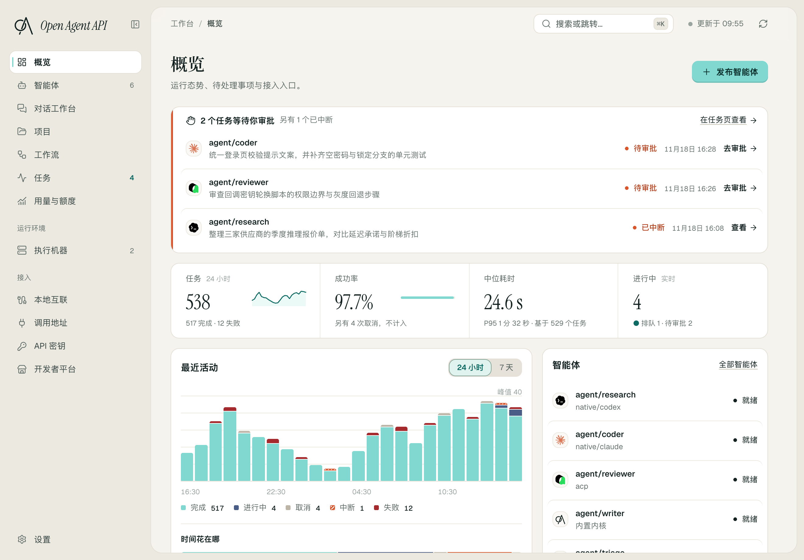

<p align="center">
  <picture>
    <source media="(prefers-color-scheme: dark)" srcset="docs/brand/oaa-mark-inverse.svg" />
    
  </picture>
</p>

<h1 align="center">Open Agent API</h1>

<p align="center">
  <strong>把智能体变成 API。</strong><br />
  调用的不是模型，而是自带工具、技能与权限的智能体：一次调用，就是一个任务。
</p>

<p align="center">
  <a href="README.md">English</a> · 简体中文
</p>

<p align="center">
  <a href="LICENSE"></a>
  <a href="package.json"></a>
  <a href="https://github.com/jiangxingfan1-coder/Open-Agent-API/actions/workflows/ci.yml"></a>
</p>

<p align="center">
  <picture>
    <source media="(prefers-color-scheme: dark)" srcset="docs/assets/hero-dark.png" />
    
  </picture>
</p>

<p align="center">
  
  <br />
  <sub>完整接入流程演示：1. 发布本机智能体（<code>agent/antigravity</code>） → 2. 生成专属 <code>sk-oaa-…</code> 密钥 → 3. 用官方 OpenAI SDK 发起流式调用并在控制台查看完成时间线。</sub>
</p>

## 三十秒看懂

业务代码不用重写。在现有的 OpenAI、Anthropic 或 Gemini SDK 里改两处——把 Base URL 指向网关地址，把 `model` 换成智能体 ID——应用就能调度自带工具和记忆的完整智能体，并能在关键写操作前停下来等你拍板。

```diff
 from openai import OpenAI

 client = OpenAI(
-    base_url="https://api.openai.com/v1",
-    api_key=OPENAI_API_KEY,
+    base_url="http://127.0.0.1:8787/v1",  # 你的 Open Agent API
+    api_key="sk-oaa-…",                   # 在控制台创建的 API 密钥
 )

 resp = client.chat.completions.create(
-    model="<某个模型>",
+    model="agent/research",               # 智能体的调用名
     messages=[{"role": "user", "content": "整理这三份报价单，比较交付周期与总价"}],
 )
 print(resp.choices[0].message.content)
```

Node.js 同理：

```diff
 import OpenAI from 'openai';

 const client = new OpenAI({
-  baseURL: 'https://api.openai.com/v1',
-  apiKey: process.env.OPENAI_API_KEY,
+  baseURL: 'http://127.0.0.1:8787/v1', // 你的 Open Agent API
+  apiKey: process.env.OAA_API_KEY, // 在控制台创建的 API 密钥
 });

 const resp = await client.chat.completions.create({
-  model: '<某个模型>',
+  model: 'agent/research', // 智能体的调用名
   messages: [{ role: 'user', content: '整理这三份报价单，比较交付周期与总价' }],
 });
 console.log(resp.choices[0].message.content);
```

对调用方来说，只需要知道服务地址和密钥。`model` 写的是智能体名字而不是某个模型名；底层挂什么模型、配了什么技能和权限边界，都在网关发布端决定。其余协议和客户端接入方式见下文[兼容的协议与 SDK](#兼容的协议与-sdk)。

## 三分钟跑起来

下面的源码路线需要 Node.js 24.18 及以上的 24 或 26 版本线（`package.json` 的 `engines` 为 `>=24.18.0 <27`）；安装包与 Linux 包自带 Node.js（其他路线见[其他安装方式](#其他安装方式)）。不需要 Redis，也不需要任何模型密钥。

### 最短路径：一条命令

```sh
git clone https://github.com/jiangxingfan1-coder/Open-Agent-API.git
cd Open-Agent-API
npm ci --omit=optional --ignore-scripts
npm run build
npm run oaa -- quickstart
```

`quickstart` 依次做五件事，并逐步打印：初始化 `.oaa/`（已初始化则跳过）→ 在后台启动网关，只监听 `127.0.0.1`（已在运行则复用）→ 发布离线示例智能体 `agent/sample` → 生成一把调用方密钥，存为私有文件 `.oaa/keys/quickstart.key`（已有且有效则复用，密钥本身不打印）→ 用这把密钥真调一次并打印回答。最后给出 Base URL、`model`、一条可以直接粘贴运行的 curl、一段官方 OpenAI SDK 的最小代码，以及「接上你自己的智能体」的下一步：本机装了 codex、claude 或 agy 时，每个只给一行 `oaa connect codex` 这样的命令；都没有时给出内置智能体加模型密钥的写法。重复运行不会重复创建。

示例智能体是仓库里的 `examples/sample-agent.mjs`：**不调用任何模型、不联网、不花钱**，回答由固定规则生成，开头写明「这是 Open Agent API 的离线示例智能体」。它演示多步执行、一次工具调用，任务里写上「审批」时还会停下来等你批准（在控制台批准，或用调用方密钥调用 `POST /v1/runs/{id}/actions/{action}`），批准后同一个任务接着完成。

默认端口是 8787；被占用时 `quickstart` 会明确报 `port_in_use`，用 `npm run oaa -- quickstart --port 18787` 换一个（端口写进 `.oaa/config.json`，下文的 `8787` 都要跟着换）。停止网关用 `npm run oaa -- stop`。

### 其他安装方式

每条安装路线跑完后用 `oaa quickstart` 起步，详细步骤与卸载方式见 [docs/zh-CN/install.md](docs/zh-CN/install.md)。从 `0.0.65` 起，[发布页](https://github.com/jiangxingfan1-coder/Open-Agent-API/releases)同步提供桌面/命令行包、Linux 安装脚本、Docker 镜像与 npm `.tgz` 包。

- **跨平台桌面应用与安装包**（macOS `arm64`/`x64` `.dmg`、Windows `x64` `.zip`、Linux `x64`/`arm64` `.tar.gz`）：自带 Node.js 24 运行时。目前安装包未做苹果公证与商业代码签名，首次打开按系统提示手动放行即可（见 install.md）。
- **Linux 一键脚本**（x64 与 arm64，glibc 2.28 及以上，不需要 root 和预装 Node.js）：

  ```sh
  curl -fsSL https://github.com/jiangxingfan1-coder/Open-Agent-API/releases/latest/download/install.sh | sh
  oaa quickstart
  ```

  脚本会用发布页同批次的 `SHA256SUMS` 校验压缩包，安装到 `~/.local` 下。
- **Docker**（仓库根目录执行 `docker compose up --build -d`）：只映射宿主机 `127.0.0.1:8787`。镜像内没有宿主机命令行智能体，主要配给「内置智能体 + 自带模型密钥」、「ACP / A2A 远程智能体」或外部工作节点回连使用。每次 push 都会跑 amd64 构建与容器烟雾测试；`ghcr.io` 多架构镜像在正式发布 Release 时推送。
- **npm tarball**（需本机 Node.js 24.18 及以上的 24/26 版本线）：`npm install -g <发布页 open-agent-api-<版本>.tgz 链接>`，随后 `oaa quickstart`。由于 `package.json` 保持 `private`，包不会发上 npmjs 官方源。

### 接上你自己的智能体：`oaa connect`

`npm run oaa -- connect codex`（或 `claude`、`agy`，以及 `oaa doctor` 列出的 ACP 智能体名）一步完成：检测它是否已安装 → 在本网关启用（只改本网关的记录，不改它自己的配置与登录）→ 发布为 `agent/codex`（已发布则跳过）→ 确认 quickstart 的密钥能调用它 → 打印 `model` 和一条可粘贴的 curl。connect **不会调用**这个智能体：第一次调用会使用它自己在这台机器上的登录状态与额度。没安装时会说明先安装并登录，再运行 quickstart 让网关识别它。

### 给内置智能体接上模型：`oaa connect <预设>`

内置智能体（网关自己的智能体循环）需要一个模型提供方。`oaa connect ollama`（本地模型，不需要密钥）或 `oaa connect deepseek --key-file ~/.config/deepseek.key`（还有 `openai`、`anthropic`、`gemini-api`、`openrouter`、`lmstudio`、`openai-compatible` 等）会把提供方写进 `.oaa/config.json`，重启由这个数据目录启动的网关，发布 `agent/assistant`（一个带工作区文件工具的通用助手），确认 quickstart 的密钥，并打印一条 curl。密钥从不在命令行里输入：`--key-env` 写变量名，`--key-file` 指向一个文件。它不会调用模型，除非你加 `--test`（只对本机地址的端点）；`oaa models` 列出已配置的提供方以及它们的密钥能不能解析。这些预设取自各服务自己的文档，只在假服务上运行过。见 [docs/zh-CN/models.md](docs/zh-CN/models.md)。

### 分步做

要发布真正干活的智能体，需要本机装好并登录过的 Codex、Claude Code、Antigravity 或某个 ACP 智能体（`npm run oaa -- doctor` 会列出找到了哪些），或者一个模型提供方的 API Key（用来跑内置智能体）。下面是 `quickstart` 背后的分步做法：

```sh
npm run oaa -- init                 # 生成 .oaa/config.json 与管理员密钥 .oaa/admin.token
npm run oaa -- serve --detach       # 后台启动，打印 {"url": …, "pid": …}；停止用 npm run oaa -- stop
```

不想后台运行就用 `npm start`（占住当前终端，后面的命令要另开一个终端）。

1. **打开控制台**：浏览器访问 `http://127.0.0.1:8787`，在连接设置里选择 `.oaa/admin.token`。这个管理员密钥不要分享。
2. **发布智能体**：在控制台点「发布智能体」。如果你是从源码或 `oaa init` 初始化的，探测到的外部 CLI 默认是停用的，需要先在「执行机器」页启用；如果是用桌面应用开箱启动，检测到已安装的本机引擎（codex、claude、agy、dsh）会自动启用，同时网关始终只绑定回环地址 `127.0.0.1`。开关状态保存在本地数据库里，不改动各外部智能体的全局配置，也不读取或中转已有登录凭据。随时可以在同一页停用。等价的命令行写法（`default` 表示沿用智能体自己的默认模型）：

   ```sh
   npm run oaa -- publish-native --id agent/codex --engine codex --models default \
     --url http://127.0.0.1:8787 --token-file .oaa/admin.token
   ```

   也可以用 OAA-Lang 或 JSON 定义一个内置智能体，见 [docs/zh-CN/language.md](docs/zh-CN/language.md) 与 [操作手册](docs/zh-CN/operations.md)（那需要一个模型提供方：上面的 `oaa connect <预设>` 可以配好，`examples/` 里的定义模板用的是占位符）。
3. **创建 API 密钥**：控制台「API 密钥」页点「生成密钥」，结果页会给出服务地址（Base URL）、API Key（形如 `sk-oaa-…`，只显示一次）和模型名，各自可以一键复制。为每个调用方应用单独创建一把。命令行的等价写法（密钥写进私有文件，不打印到屏幕上）：

   ```sh
   npm run oaa -- key create --name myapp --agent agent/codex \
     --url http://127.0.0.1:8787 --token-file .oaa/admin.token
   ```

   输出里的 `token_file` 是存放密钥的文件（默认 `.oaa/keys/myapp.key`），`base_url` 和 `model` 就是上面 SDK 代码要填的两样，`try` 是一条可以直接粘贴运行的 curl 命令。默认权限是调用、读取、上传文件；要让这把密钥也能批准审批，加 `--approve`。
4. **第一次调用**：把上面的 Python 或 Node 代码里的三样东西换成你的，或者直接运行上一步输出的 `try` 命令。命令行也可以提交后台任务：

   ```sh
   npm run oaa -- invoke agent/codex --input '你的任务' \
     --url http://127.0.0.1:8787 --token-file .oaa/keys/myapp.key
   npm run oaa -- wait <上一步输出的 id> --url http://127.0.0.1:8787 --token-file .oaa/keys/myapp.key
   ```

   `invoke` 立即返回任务 `id`（状态 `queued`），`wait` 等它结束，`output` 读取输出文字。不想每次都写 `--url` 与 `--token-file`，可以设置环境变量 `OAA_GATEWAY_URL` 与 `OAA_TOKEN_FILE`。这次调用会出现在控制台的任务列表里。

模型别名由发布者声明，并不代表上游账号确实可用。

### 常见报错

| 现象 | 原因与下一步 |
| --- | --- |
| HTTP 401 `unauthorized` | 没带密钥或密钥无效。OpenAI / Claude / Gemini 的 SDK 分别用 `Authorization: Bearer`、`x-api-key`、`x-goog-api-key` 发送，填上第 3 步的密钥 |
| HTTP 403 `scope_denied` | 这把密钥没有授权这个 `model`。最常见的原因是 `model` 写错了：用这把密钥请求 `GET /v1/models` 看它能调用哪些智能体 |
| HTTP 404 `agent_not_found` | 网关里没有这个智能体（用管理员密钥调用时才会看到这个码）。同样先看 `GET /v1/models` |
| HTTP 503 `model_unavailable` | 智能体已发布，但没有能执行它的地方：外部智能体没安装或没在「执行机器」里启用，或内置智能体的模型提供方没配好（例如没有设置 `OPENAI_API_KEY`）。`npm run oaa -- doctor` 列出本机找到的智能体 |
| 命令行 `gateway_unreachable`，SDK 报 `Connection error` | 网关没启动或地址不对：`npm run oaa -- serve --detach`，或检查 `--url` 与 `.oaa/config.json` 里的端口 |

### 不装任何智能体也能看的能力

`quickstart` 发布的 `agent/sample` 就是为此准备的：用它可以亲手看到多步执行与工具调用（任务检查器的时间线与步骤），以及任务里写「审批」时的持久审批。它不能续接会话（带 `previous_response_id` 的调用会被 `native_resume_unsupported` 拒绝，因为它的 ACP 进程既没有声明 `session/load` 也没有声明 `session/resume`），取消时运行以 `incomplete` 而不是 `cancelled` 结束。需要续接、取消、恢复、异常等更多行为时，仓库的 `test/fixtures/acp-agent.mjs` 是测试用的 ACP 替身（只在源码目录里有），接法与示例智能体相同：在 `.oaa/config.json` 的 `localWorker.adapters` 里加一项 `{"transport":"acp","command":"<node 绝对路径>","args":["<仓库绝对路径>/test/fixtures/acp-agent.mjs","stream"],"enabled":true}`，重启网关后 `publish-native --engine adapter/<名字>`；输入里带 `MODE:permission` 时停在待审批，带 `MODE:hang` 时一直运行，可以用 `npm run oaa -- cancel <id>` 取消。

另有 `npm run demo`：在进程内用本地确定性模型跑一遍内核（不启动网关），写出 `.oaa-demo/report.md`。

## 它和模型中转平台有什么不同

模型中转平台分发的是模型的推理额度；这里分发的是完整的智能体。它借用了那类平台的形态（账号、密钥、额度、用量、后台），不借用它们的供给方式：不做订阅池，不中转登录态。

| | 模型中转平台 | Open Agent API |
| --- | --- | --- |
| 分发的东西 | 模型的推理额度 | 智能体：自带工具、技能、模型线路与权限的完整执行单元 |
| `model` 填什么 | 模型名 | 智能体的调用名，如 `agent/research` |
| 一次调用是什么 | 一次模型补全 | 一个任务：多轮工具循环，可审批、可中断、可恢复，有产物 |

## 能接入哪些智能体

被调用的既可以是 OAA-Lang / JSON 定义的内置智能体，也可以是这台机器上装好的外部 CLI 智能体。外部智能体保留它原有的工具、模型和登录态，网关把它们包装成一致的接口，统一接管任务调度、审批暂停、断点恢复、并发限流和用量记录。

| 接入方式 | 流式文本 | 运行中审批 | 调用方工具桥接 | 图片输入 | 说明 |
| --- | --- | --- | --- | --- | --- |
| 内置内核（OAA-Lang / JSON） | 逐 token | 支持（声明需审批的工具会挂起） | 支持 | 模型支持时可用 | 多路线与故障转移，支持 OAA-Lang 2.5、Cron 与 Webhook 触发 |
| Codex CLI | 逐 token | 支持 | 支持（`oaa-caller` MCP 与 elicitation 自动放行） | 协议条目按文档实现（真机传图未实测） | app-server 接入，支持 `thread/resume` 续接、`turn/interrupt` 优雅取消与无工具规划 |
| Claude Code | 逐 token（增量去重） | 支持 | 支持（`oaa-caller` MCP） | 内容块按文档实现（真机传图未实测） | 走官方 Agent SDK（专有运行时另装），沿用本机 CLI 登录配置 |
| Antigravity | 逐 token | `agy acp` 完整桥接；旧 headless 拒绝即失败 | 原生 headless 与 `agy acp` 均已支持 | ACP 按声明；其余作工作区文件 | 支持真实模型发现，自动按能力选择传输路径 |
| ACP 智能体 | 逐 token | 支持（仅 `allow_once`） | 支持 | 声明支持用图片块，否则作文件 | [Agent Client Protocol](https://agentclientprotocol.com)，内置 `qoder`、`opencode-acp`、`grok-build-acp`、`deepseek-harness` 等预设 |
| 自写适配器（`oaa/1` / HTTP） | 取决于所选形式 | `oaa/1-stream` 支持 | 不支持 | stdio 作文件；HTTP 不支持 | 给自定义程序包一层标准外衣 |
| A2A 远程智能体 | 支持（SSE） | 不桥接（`input-required` 回传问题） | 不支持 | 不支持 | 通过 `contextId` 续接同一任务 |

这张表是能力摘要，各接入方式的详细对照见 [docs/zh-CN/adapters.md](docs/zh-CN/adapters.md#agentapi-转换契约2026-11-08)，接口返回的 `conversion` 字段也带同一份画像。几点使用边界：

- 接入差异在于**交互深度**（`basic` / `streaming` / `interactive`），不在能不能连入；四类路径都能发布为同一套 Agent API。
- 外部智能体继承宿主进程权限。除非在 POSIX 上启用或配置沙盒策略，单次调用可访问宿主机运行时允许的路径；调用外部智能体的密钥需有 `host` 执行权限等级，对外开放前先看[公网部署](docs/zh-CN/deploy-public.md)。
- `--approvals auto` 会自动放行外部智能体的权限询问，只适合可信调用方（风险见 [docs/zh-CN/protocol.md](docs/zh-CN/protocol.md#approval-policy-for-external-agents-approval-policy-v1)）。
- 当调用方是 Cursor、Cline、Claude Code 等智能体时，`auto` 模式会把请求里的 `tools` 交给能接管的后端执行代理——代理发起外部工具调用后，网关以标准 `tool_calls` 交回给调用方执行，传回结果再续跑同一任务；还支持显式指定 `managed`、`bridge`、`reject` 或通过 `clientTools.default` 修改全局默认（见 [docs/zh-CN/harness.md](docs/zh-CN/harness.md)）。
- 不接收图片的智能体在创建任务前直接报错拒绝；`GET /v1/models` 会标出 `image_input`，默认不主动抓取外网图片 URL（见 [docs/zh-CN/images.md](docs/zh-CN/images.md)）。
- 也支持直接走 MCP 入口发现和调度智能体（`npm run oaa -- mcp`，或用控制台「连接」页、`oaa integration` 一键写入配置，见[操作手册](docs/zh-CN/operations.md)）。安全边界使然，MCP 工具刻意不暴露审批决定接口。

## 兼容的协议与 SDK

| 入口 | 官方 SDK 的验证情况 |
| --- | --- |
| OpenAI Chat Completions 与 Responses（流式与非流式） | 仓库里有常驻的回归测试，用官方 `openai` Node SDK 经进程内网关运行，不监听端口；下面的兼容性实验室还会让 Python 与 Node 的 SDK 经套接字运行 |
| Claude Messages | 同样有常驻的回归测试，用官方 `@anthropic-ai/sdk` 1.3.0；实验室运行 Python SDK 和更新的 Node SDK |
| Gemini `generateContent` / `streamGenerateContent` | 实验室运行 `google-genai`（Python）与 `@google/genai`（Node）；回归测试按线上格式断言。更早的一次性实测用临时安装的 `@google/genai` 3.2.0，探测脚本在 [examples/gemini-sdk-probe.mjs](examples/gemini-sdk-probe.mjs) |
| `oaa/1` 原生协议、UAP/1、MCP | 见 [docs/zh-CN/protocol.md](docs/zh-CN/protocol.md) |

除这些回归测试外，兼容性实验室（`npm run compat`，CI 里每次 push 与每周都会跑）用真实的包去打一个隔离的离线网关，网关里的智能体是示例智能体或确定性夹具，不是真实的智能体：官方 `openai`、`anthropic`、`google-genai` 的 Python SDK 与对应的 Node SDK、Vercel AI SDK、LangChain、LiteLLM、OpenAI Agents SDK、LlamaIndex。Open WebUI、LibreChat、Chatbox、Cherry Studio、LobeChat、NextChat、Dify、n8n、Continue、Cline / Roo Code、Zed 没法在测试里装起来跑，所以按它们源码里读到的请求形状回放；Cursor 闭源，未核实。哪些是实际运行、哪些是回放，各客户端怎么配置，以及不支持或被忽略的参数怎么处理，见 [docs/zh-CN/compatibility.md](docs/zh-CN/compatibility.md)。

任何兼容这几家协议的客户端，只要填 Base URL 和 API 密钥就能用；`Authorization: Bearer`、`x-api-key`、`x-goog-api-key` 三种鉴权头都接受。不支持的输入会明确报错，而不是悄悄降级：例如音频和其他内联的二进制内容一律返回 400 `unsupported_content`，需要先经 `POST /v1/files` 上传再引用；只影响采样的参数（`temperature`、`top_k` 等）会被接受并忽略，响应头 `X-OAA-Ignored-Params` 会说明忽略了哪些。见 [docs/zh-CN/protocol.md](docs/zh-CN/protocol.md#兼容入口的参数错误与结束原因060)。

**流式里的过程。** 流式调用还可以显示智能体在做什么：运行的每个阶段（排队、调用了某个工具、等待审批）发一行简短的说明，用各协议自己的思考形状，所以已经会显示模型思考的客户端不用改动就能显示它。Responses 与 Gemini 默认开，Chat Completions 与 Claude Messages 默认关；可以按请求用 `X-OAA-Progress: reasoning | off` 切换，也可以在配置里按协议用 `streamProgress` 设置。答案本身不会变。见 [docs/zh-CN/progress.md](docs/zh-CN/progress.md)。

除了文字，调用方还可以指定**图片**（[docs/zh-CN/images.md](docs/zh-CN/images.md)）、**强制 `tool_choice`**（`none`、`auto`、`required` 或具名函数，原生驱动直接下推，桥接智能体做有界纠偏，仍未满足报 `tool_choice_unmet`）和**保证符合 JSON Schema 的结构化输出**（`response_format`、`text.format`、`responseSchema`、`output_config.format`）：支持原生结构化输出的模型驱动直接下推并透传流式，其余路径由网关校验与修正，超限则明确失败（`structured_output_invalid`），不敷衍返回伪 JSON（[docs/zh-CN/structured-output.md](docs/zh-CN/structured-output.md)）。

## 控制面、工作台与工作站能力

智能体会读写文件、跑命令、调外部工具。网关不把这些当作一次请求里的瞬态过程，而是做成有状态的持久任务，人可以随时停下、检查并续跑。

- **审批与快捷面板**：遇到需要确认的操作时任务进入持久挂起态，可通过 Web 控制台、对话工作台行内卡片、桌面托盘快捷审批小窗、命令行（`oaa approvals`、`oaa approve`、`oaa deny`）或 `approve` 密钥接口决定放行或拒绝。
- **控制台对话工作台（`#workbench`）与双通道本机连接**：工作台自带多轮续接（`previous_response_id`）、截图粘贴、工具桥接模拟器与四协议 SDK/curl 导出；「连接」页可直接为 Codex、OpenCode、DSH 写 Provider 配置，或为 Claude Desktop、Cursor、Windsurf、Claude Code 一键配置 MCP 桥接（统一使用 `0600` 私有密钥文件）。
- **通用编排、持久记忆与大产物**：支持跨引擎自动编排（`@fast`、`@best`、`@eco`、`recommend` 无工具规划、显式 `orchestration.planner` 规划者、失败自动切换）与 OAA-Lang 2.5 管线；提供 SQLite FTS5 全文记忆检索（`memory_read`、`memory_write`、`memory_search`）、时区感知 Cron 调度与 SHA-256 签名入站 Webhook 触发器；大文件产物改为流式校验与下载（默认上限 64 MiB，可配至 256 MiB）。
- **中断恢复、幂等、回调与可观测**：任意时刻可取消（不可知状态的外部写入恢复前必须人工确认）；所有入口支持 `Idempotency-Key`（冲突返回 409）；支持事件 Webhook（`oaa webhook add`）、任务时间线与事件回放、W3C `traceparent` 传播、Prometheus `/metrics` 指标，以及 POSIX 上按调用方隔离的 `srt` 沙盒池。

<p align="center">
  <picture>
    <source media="(prefers-color-scheme: dark)" srcset="docs/assets/inspector-dark.png" />
    
  </picture>
</p>

<p align="center">
  <picture>
    <source media="(prefers-color-scheme: dark)" srcset="docs/assets/runs-dark.png" />
    
  </picture>
</p>

控制台创建 API 密钥后的结果页，给出的就是调用方需要的全部：

<p align="center">
  <picture>
    <source media="(prefers-color-scheme: dark)" srcset="docs/assets/api-key-dark.png" />
    
  </picture>
</p>

控制台的使用说明见 [docs/zh-CN/console.md](docs/zh-CN/console.md)。

## 作为开发者平台对外提供

网关可以作为开发者平台对外提供：开发者自助注册，在门户里创建自己的 API 密钥，按任务计点调用你上架的智能体。在控制台「开发者平台」页点「启用」即可（保存后重启网关生效），你在同一页上架智能体、定价、发放点数、管理账号；也可以在配置文件里写 `platform` 段。不启用时这些功能都不存在，网关的行为不变。

<p align="center">
  <picture>
    <source media="(prefers-color-scheme: dark)" srcset="docs/assets/portal-dark.png" />
    
  </picture>
</p>

默认情况下，开发者只能调用内置智能体。运营者也可以把一个外部智能体（Codex、Claude Code、ACP 智能体）上架给平台账号，逐个上架项放开，开关默认关闭：打开后这个智能体以运行网关的系统用户的权限运行，所以请先读安全说明。每个任务的价格在任务开始时预扣，任务没有完成就退回；按 token 的扣费不会把余额扣成负数；不上报 token 用量的智能体只能按次定价。

点数是运营者发放的记账单位，平台不接支付、不发邮件。计费规则、接口与限制见 [docs/zh-CN/platform.md](docs/zh-CN/platform.md)。

## 桌面应用与命令行

- **命令行**：`oaa --help`（源码目录 `npm run oaa -- --help`）涵盖 `quickstart`、`connect`、`init`、`serve`、`stop`、`status`、`doctor`、`models`、`prune`、`key create`、`publish`、`publish-native`、`invoke`、`wait`、`approvals`、`approve`、`deny`、`webhook`、`verify`、`cancel`、`resume`、`nodes`、`mcp`，以及零模型开销的 `check` / `fmt`。完整命令按任务分类整理在 [docs/zh-CN/cli.md](docs/zh-CN/cli.md)。
- **跨平台桌面应用（Electron）**：源码在 `desktop/cross-platform`（替代已归档的 `desktop/macos` Swift 外壳），统一面向 macOS（`arm64`/`x64`）、Windows（`x64`）与 Linux（`x64`/`arm64`）。外壳严格开启渲染进程沙盒与 `contextIsolation`，内嵌同一套控制台，附带托盘快捷审批面板、Dock/托盘实时审批角标、双语审批通知、三态端口归属诊断、崩溃后自家孤儿网关自动接管与开机自启开关（隔离模式下禁用）。常用脚本：`npm run desktop:dev`、`npm run desktop:smoke`、`npm run desktop:smoke:matrix`，打包命令 `npm run package:mac` / `package:win` / `package:release:linux`；隔离调试环境变量（`OAA_DESKTOP_HOME`、`OAA_DESKTOP_PORT`）见 [install.md](docs/zh-CN/install.md#macos) 与 [releasing.md](docs/zh-CN/releasing.md)。

## 文档

按「我想……」组织的完整索引在 [docs/zh-CN/README.md](docs/zh-CN/README.md)。常用入口：[五分钟上手](docs/zh-CN/quickstart.md)、[安装](docs/zh-CN/install.md)、[命令行](docs/zh-CN/cli.md)、[操作手册](docs/zh-CN/operations.md)、[协议](docs/zh-CN/protocol.md)、[与 SDK 和客户端的兼容](docs/zh-CN/compatibility.md)、[结构化输出](docs/zh-CN/structured-output.md)、[图片输入](docs/zh-CN/images.md)、[事件回调](docs/zh-CN/webhooks.md)、[模型提供方](docs/zh-CN/models.md)、[流式里的运行过程](docs/zh-CN/progress.md)、[稳定性与数据保留](docs/zh-CN/stability.md)、[双层 Harness](docs/zh-CN/harness.md)、[OAA-Lang](docs/zh-CN/language.md)、[接入外部智能体](docs/zh-CN/adapters.md)、[控制台](docs/zh-CN/console.md)、[Windows](docs/zh-CN/windows.md)、[公网部署](docs/zh-CN/deploy-public.md)、[安全模型](docs/zh-CN/security-model.md)、[开发者平台](docs/zh-CN/platform.md)、[架构](docs/zh-CN/architecture.md)、[验证证据](docs/zh-CN/evidence.md)、[工程规范](docs/zh-CN/engineering.md)、[变更记录](CHANGELOG.zh-CN.md)、[路线图](ROADMAP.zh-CN.md)。可复制运行的调用示例（curl、Python、Node）在[示例集](examples/cookbook/README.zh-CN.md)里。`node tools/docs-site/build.mjs` 会把全部文档（中英文，带搜索）生成为静态站点，由 Pages 工作流发布。

## 现状与边界

下面是到目前为止实测验证过什么、哪些还没有覆盖，不作未来规划承诺。带日期与观测值的完整记录在 [docs/zh-CN/evidence.md](docs/zh-CN/evidence.md)。

**测试与 CI**

- 仓库使用 `node:test` 维护着 `1,305` 项自动化测试；`npm run verify` 执行 TypeScript 检查、Prettier 排版检查与全量测试，`npm run test:offline` 运行无端口监听子集。
- CI 在 Ubuntu（x64/arm64）、macOS（arm64/Intel）与 Windows 上持续跑校验与打包烟雾检查（POSIX 专属用例在 Windows 上明确原因跳过），并同步构建/烟雾测试 Docker amd64 镜像与运行兼容性实验室。
- 单元测试与兼容性实验室主要跑本地确定性模型与协议替身；它们保障协议编解码、状态机、权限隔离和故障恢复契约，但不代替真实厂商账号配额与云端模型效果评测。实验室覆盖 `14` 个客户端共 `456` 个场景；无法在测试环境安装的桌面/浏览器客户端（如 Open WebUI、LibreChat、Continue、Cline、Zed 等）依据其公开源码抓包形状做离线回放，闭源 `Cursor` 未核实，详见 [docs/zh-CN/compatibility.md](docs/zh-CN/compatibility.md)。
- 稳定性压测（`npm run soak`）在 macOS 与 Linux 上完成过 32 分钟（含 3 次重启恢复）和 62 分钟单段测试，2026-11-18 并在 macOS 补做 `0.0.70` 2 分钟抽样（`ok=2357`、`unexpected=0`）与 `test/sandbox-srt.test.ts`（5/5 通过），[docs/zh-CN/stability.md](docs/zh-CN/stability.md) 记有指标与崩溃恢复约束。

**真实智能体验证**

- **Qoder CLI `1.1.52`（ACP）**：2026-11-18 完整通过 `oaa verify` 全 11 场景（14 次调用、0 失败，含流式、续接、批准/拒绝写文件、取消、调用方工具桥接与并发），并走通真实外部智能体 `S10` 开发者平台计费全路径（当前 ACP 响应未带非零 token 用量，按次计费）。
- **Antigravity `1.5.10`**：通过原生引擎 `S1`–`S5`、`S7`、`S8`（调用方工具桥接）、`S9`、`S11`–`S12` 以及 `agy acp` 联调；仅原生 headless `S6` 运行中权限审批按设计不支持。
- **Codex `0.167.0`**：通过 `S2` 流式（上报真实用量）、`S7` 协议级 `turn/interrupt` 优雅取消与无工具推理编排；`S8` 调用方工具桥接在真机复验时遇到账户额度耗尽至 2026-11-21（对应的 elicitation 解析与自动放行逻辑已在单元测试和集成测试中全过）。
- **其余本机实测与待补项**：`Claude Code 2.1.318` 与 `Grok 1.0.77` 未登录态精确返回 `adapter_auth_required`；`OpenCode 1.18.29` 透传密钥过期报错；`DeepSeek Harness` 在本机受 `~/.dsh` 写锁超时阻断。Codex/Claude 真实环境的图片传入及 `oaa connect <预设>` 对全列表真实云厂商 API 的长期调用，目前仍按文档实现并经假服务端检查。欢迎装有对应环境的开发者运行 `oaa verify` 并通过[智能体验证报告](https://github.com/jiangxingfan1-coder/Open-Agent-API/issues/new/choose)反馈实测记录。

**安装与跨平台边界**

- macOS `arm64` 已完成本地源码与打包安装版（`/Applications/Open Agent API.app`）全矩阵 Playwright E2E（`desktop:smoke` 与 `desktop:smoke:matrix`），并对挂盘 `--release` `.dmg` 跑通完整 `smoke-release.mjs` + `smoke-flow.mjs`（353 个模块 import、三协议、API/CLI 审批、幂等、停服零残留）。
- 尚未真机实测覆盖的范围：macOS Intel（`x64`）真机、macOS「系统设置 › 语言与地区」切换重启后的系统菜单语言、OS 原生审批通知跳转、Windows 与 Linux 真机桌面 GUI 端到端以及 Windows/Linux 上的真实智能体；Windows 端暂不支持本地沙盒隔离。macOS 与 Windows 安装包默认未经签名公证。

**开发者平台与其它**

- 单网关配 SQLite：不做多实例横向扩展、Postgres 或多发布方结算；不含支付通道或邮件找回密码（重置码由运营者线下分发）；限流状态记录（除已持久化部分的平台配额外）重启会按策略收敛。
- 默认禁止开发者账号密钥调用外部智能体（`403 isolation_required`），需管理员按条目开启 `host_execution: true`（该开关审计入库，且全计费流水已在真实 `qoder-cli` 上实测扣费成功）。
- 外部智能体若不报告非零 token 用量，只适用按次计费；报告的 token 仅用于参考与计量，不充当强上限费用保险箱。
- 事件回调仅对本机测试接收端跑通，未验证真实公网 HTTPS 与反向代理后的多机跨网调用；文档站经生成器与链接检查，随推送发布到 GitHub Pages。
- 默认不自动删旧运行记录，需通过 `retention.runsDays` 或 `oaa prune` 定期清理；网关不主动扫描主目录寻钥、不做基础模型训练，也不充当订阅账号共享池。

## 参与、安全与行为准则

欢迎提 issue 与 Pull Request：见 [CONTRIBUTING.zh-CN.md](CONTRIBUTING.zh-CN.md)。发现安全漏洞请阅读 [SECURITY.zh-CN.md](SECURITY.zh-CN.md)，不要公开提交。参与即表示同意遵守 [CODE_OF_CONDUCT.zh-CN.md](CODE_OF_CONDUCT.zh-CN.md)。

## 许可与署名

本项目以 [Apache License 2.0](LICENSE) 授权，版权声明与必须保留的署名见 [NOTICE](NOTICE)。第三方组件的许可与署名见 [THIRD_PARTY_NOTICES.md](THIRD_PARTY_NOTICES.md)。注意：运行时依赖 `@anthropic-ai/claude-agent-sdk` 是 Anthropic 的专有软件，由使用者自行从 npm 安装并受其自身条款约束，本项目的许可证不覆盖它（详见 THIRD_PARTY_NOTICES.md）。

ACP 智能体接入预设的元数据，以及部分智能体图标，改编自 [Open Design](https://github.com/nexu-io/open-design)（Apache-2.0，Copyright 2026 Open Design contributors），具体范围与许可证文本见 [NOTICE](NOTICE) 与 [licenses/OpenDesign-APACHE-2.0.txt](licenses/OpenDesign-APACHE-2.0.txt)。界面使用的字体（Geist、Geist Mono、Instrument Serif、Noto Serif SC）均为 SIL OFL 1.1 许可，许可证文本在 [licenses/](licenses/) 目录。
