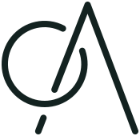
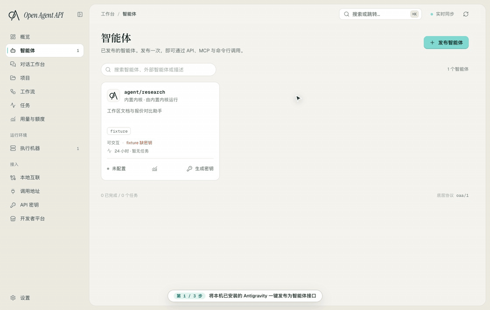
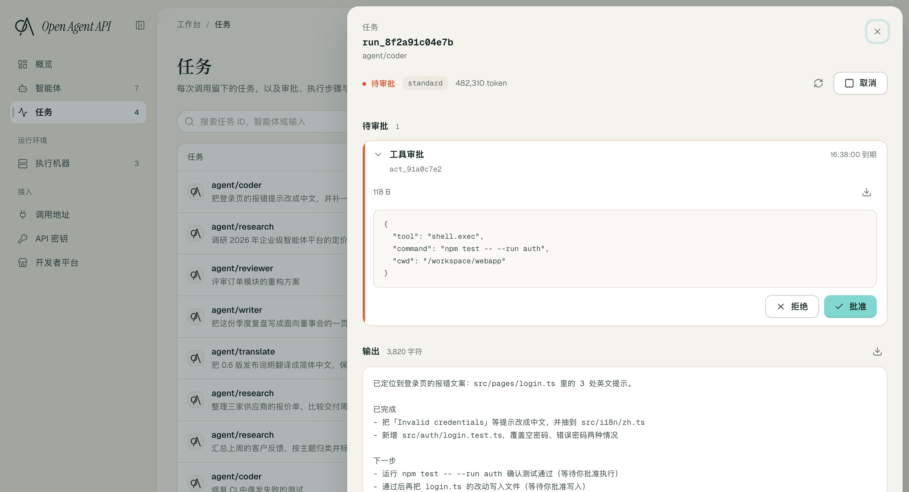
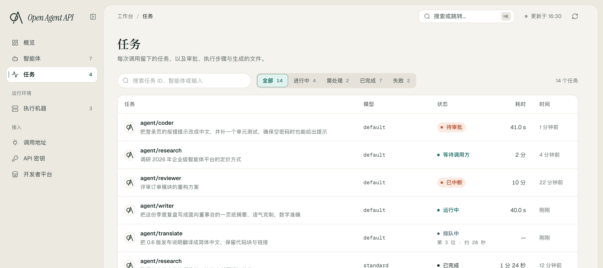
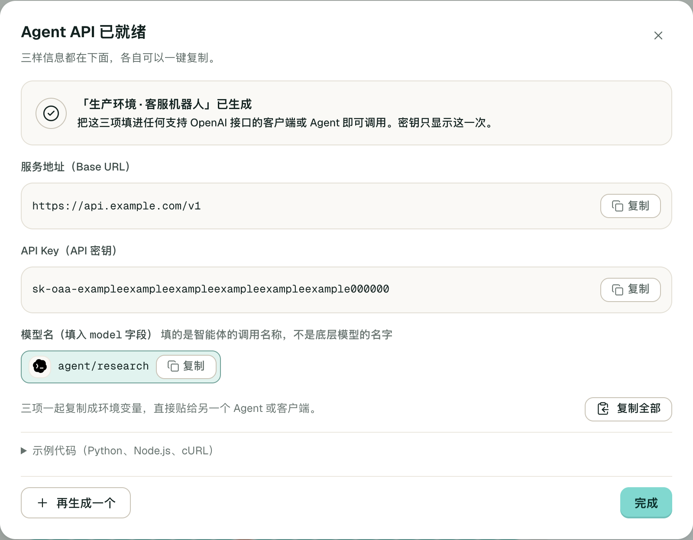
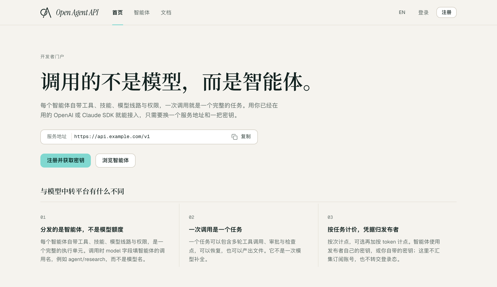

<p align="center">
  <picture>
    <source media="(prefers-color-scheme: dark)" srcset="docs/brand/oaa-mark-inverse.svg" />
    
  </picture>
</p>

<h1 align="center">Open Agent API</h1>

<p align="center">
  <strong>把智能体变成 API。</strong><br />
  调用的不是模型，而是自带工具、技能与权限的智能体：一次调用，就是一个任务。
</p>

<p align="center">
  <a href="README.md">English</a> · 简体中文
</p>

<p align="center">
  <a href="LICENSE"></a>
  <a href="package.json"></a>
</p>
<!-- 仓库公开后再加 CI 徽章；star 数等动态徽章同理，不要在公开前放需要仓库数据的徽章。 -->

<p align="center">
  <picture>
    <source media="(prefers-color-scheme: dark)" srcset="docs/assets/hero-dark.png" />
    
  </picture>
</p>

<p align="center">
  
  <br />
  <sub>真实录制：调用的是本机的 Antigravity 智能体，实际耗时 8.5 秒，画面已加速。</sub>
</p>

## 三十秒看懂

把现有应用里的 Base URL 改一行，它就多了一个会干活、会停下来等你批准的智能体。下面是同一段 OpenAI SDK 代码，只改 `base_url` 与 `model` 两处（`api_key` 换成控制台里创建的密钥）。

```diff
 from openai import OpenAI

 client = OpenAI(
-    base_url="https://api.openai.com/v1",
-    api_key=OPENAI_API_KEY,
+    base_url="http://127.0.0.1:8787/v1",  # 你的 Open Agent API
+    api_key="sk-oaa-…",                   # 在控制台创建的 API 密钥
 )

 resp = client.chat.completions.create(
-    model="<某个模型>",
+    model="agent/research",               # 智能体的调用名
     messages=[{"role": "user", "content": "整理这三份报价单，比较交付周期与总价"}],
 )
 print(resp.choices[0].message.content)
```

Node.js 同理：

```diff
 import OpenAI from 'openai';

 const client = new OpenAI({
-  baseURL: 'https://api.openai.com/v1',
-  apiKey: process.env.OPENAI_API_KEY,
+  baseURL: 'http://127.0.0.1:8787/v1', // 你的 Open Agent API
+  apiKey: process.env.OAA_API_KEY, // 在控制台创建的 API 密钥
 });

 const resp = await client.chat.completions.create({
-  model: '<某个模型>',
+  model: 'agent/research', // 智能体的调用名
   messages: [{ role: 'user', content: '整理这三份报价单，比较交付周期与总价' }],
 });
 console.log(resp.choices[0].message.content);
```

对调用方而言，只有 Base URL 和 API Key 两样东西。`model` 填的是智能体的调用名，不是底层模型的名字；背后用哪个模型，由发布者在发布智能体时声明。Anthropic 与 Gemini 的 SDK 同样只需换服务地址和密钥，见下文[兼容的协议与 SDK](#兼容的协议与-sdk)。

## 三分钟跑起来

下面的源码路线需要 Node.js 24.18 及以上（24.x，`package.json` 的 `engines` 为 `>=24.18.0 <25`）；安装包与 Linux 包自带 Node.js（其他路线见[其他安装方式](#其他安装方式)）。不需要 Redis，也不需要任何模型密钥。

### 最短路径：一条命令

```sh
git clone https://github.com/jiangxingfan1-coder/Open-Agent-API.git
cd Open-Agent-API
npm ci --omit=optional --ignore-scripts
npm run build
npm run oaa -- quickstart
```

`quickstart` 依次做五件事，并逐步打印：初始化 `.oaa/`（已初始化则跳过）→ 在后台启动网关，只监听 `127.0.0.1`（已在运行则复用）→ 发布离线示例智能体 `agent/sample` → 生成一把调用方密钥，存为私有文件 `.oaa/keys/quickstart.key`（已有且有效则复用，密钥本身不打印）→ 用这把密钥真调一次并打印回答。最后给出 Base URL、`model`、一条可以直接粘贴运行的 curl、一段官方 OpenAI SDK 的最小代码，以及「接上你自己的智能体」的下一步：本机装了 codex、claude 或 agy 时，每个只给一行 `oaa connect codex` 这样的命令；都没有时给出内置智能体加模型密钥的写法。重复运行不会重复创建。

示例智能体是仓库里的 `examples/sample-agent.mjs`：**不调用任何模型、不联网、不花钱**，回答由固定规则生成，开头写明「这是 Open Agent API 的离线示例智能体」。它演示多步执行、一次工具调用，任务里写上「审批」时还会停下来等你批准（在控制台批准，或用调用方密钥调用 `POST /v1/runs/{id}/actions/{action}`），批准后同一个任务接着完成。

默认端口是 8787；被占用时 `quickstart` 会明确报 `port_in_use`，用 `npm run oaa -- quickstart --port 18787` 换一个（端口写进 `.oaa/config.json`，下文的 `8787` 都要跟着换）。停止网关用 `npm run oaa -- stop`。

### 其他安装方式

每条路线最后都是 `oaa quickstart`。各路线的最短步骤、适用范围与卸载方法见 [docs/zh-CN/install.md](docs/zh-CN/install.md)。Linux 包、`install.sh`、npm tarball 与 Docker 镜像随 0.0.64 之后的版本发布。

- **macOS 与 Windows 安装包**（`.dmg`、`.zip`）：从[发布页](https://github.com/jiangxingfan1-coder/Open-Agent-API/releases)下载。自带 Node.js；未做公证与代码签名，第一次打开要多点一下（步骤见 install.md）。
- **Linux，x64 与 arm64**（glibc 2.28 及以上；不需要 root，也不需要装 Node.js）：

  ```sh
  curl -fsSL https://github.com/jiangxingfan1-coder/Open-Agent-API/releases/latest/download/install.sh | sh
  oaa quickstart
  ```

  脚本会用发布页的 `SHA256SUMS` 校验下载，装到 `~/.local` 下。
- **Docker**（在仓库目录里 `docker compose up --build -d`）：网关只发布在宿主机的 `127.0.0.1:8787`。容器里没有宿主机上装的命令行智能体（没有 Codex、没有 Claude Code），所以适合：用你自己的模型密钥的内置智能体、ACP / A2A 远程智能体、以及连进来的执行节点。Dockerfile 还没有在 CI 之外构建过，第一次验证的构建就是 CI 那一次。
- **npm tarball**（需要 Node.js 24.18 及以上）：`npm install -g <发布页上 open-agent-api-<版本>.tgz 的地址>`，然后 `oaa quickstart`。这个包是 `private` 的，不在 npm 官方源上。

### 接上你自己的智能体：`oaa connect`

`npm run oaa -- connect codex`（或 `claude`、`agy`，以及 `oaa doctor` 列出的 ACP 智能体名）一步完成：检测它是否已安装 → 在本网关启用（只改本网关的记录，不改它自己的配置与登录）→ 发布为 `agent/codex`（已发布则跳过）→ 确认 quickstart 的密钥能调用它 → 打印 `model` 和一条可粘贴的 curl。connect **不会调用**这个智能体：第一次调用会使用它自己在这台机器上的登录状态与额度。没安装时会说明先安装并登录，再运行 quickstart 让网关识别它。

### 分步做

要发布真正干活的智能体，需要本机装好并登录过的 Codex、Claude Code、Antigravity 或某个 ACP 智能体（`npm run oaa -- doctor` 会列出找到了哪些），或者一个模型提供方的 API Key（用来跑内置智能体）。下面是 `quickstart` 背后的分步做法：

```sh
npm run oaa -- init                 # 生成 .oaa/config.json 与管理员密钥 .oaa/admin.token
npm run oaa -- serve --detach       # 后台启动，打印 {"url": …, "pid": …}；停止用 npm run oaa -- stop
```

不想后台运行就用 `npm start`（占住当前终端，后面的命令要另开一个终端）。

1. **打开控制台**：浏览器访问 `http://127.0.0.1:8787`，在连接设置里选择 `.oaa/admin.token`。这个管理员密钥不要分享。
2. **发布一个智能体**：在控制台点「发布智能体」。用源码或命令行（`oaa init`）初始化时，发现的外部智能体默认是**停用**的，需要先在控制台「执行机器」里启用；macOS 桌面应用为了开箱即用，启动时会把检测到已安装的本机智能体（codex、claude、agy、dsh）设为启用，网关只监听本机回环地址 `127.0.0.1`，不想让某个智能体可被调用就在「执行机器」里把它停用（选择记在本地数据库里）。开关只记在本平台里，不改动外部智能体自己的全局配置，也不提取或修改已有的凭据。命令行的等价写法（`default` 表示沿用外部智能体自己配置的模型）：

   ```sh
   npm run oaa -- publish-native --id agent/codex --engine codex --models default \
     --url http://127.0.0.1:8787 --token-file .oaa/admin.token
   ```

   也可以用 OAA-Lang 或 JSON 定义一个内置智能体，见 [docs/zh-CN/language.md](docs/zh-CN/language.md) 与 [操作手册](docs/zh-CN/operations.md)（那需要你自己配置模型提供方，仓库里的示例用的是占位符）。
3. **创建 API 密钥**：控制台「API 密钥」页点「生成密钥」，结果页会给出服务地址（Base URL）、API Key（形如 `sk-oaa-…`，只显示一次）和模型名，各自可以一键复制。为每个调用方应用单独创建一把。命令行的等价写法（密钥写进私有文件，不打印到屏幕上）：

   ```sh
   npm run oaa -- key create --name myapp --agent agent/codex \
     --url http://127.0.0.1:8787 --token-file .oaa/admin.token
   ```

   输出里的 `token_file` 是存放密钥的文件（默认 `.oaa/keys/myapp.key`），`base_url` 和 `model` 就是上面 SDK 代码要填的两样，`try` 是一条可以直接粘贴运行的 curl 命令。默认权限是调用、读取、上传文件；要让这把密钥也能批准审批，加 `--approve`。
4. **第一次调用**：把上面的 Python 或 Node 代码里的三样东西换成你的，或者直接运行上一步输出的 `try` 命令。命令行也可以提交后台任务：

   ```sh
   npm run oaa -- invoke agent/codex --input '你的任务' \
     --url http://127.0.0.1:8787 --token-file .oaa/keys/myapp.key
   npm run oaa -- wait <上一步输出的 id> --url http://127.0.0.1:8787 --token-file .oaa/keys/myapp.key
   ```

   `invoke` 立即返回任务 `id`（状态 `queued`），`wait` 等它结束，`output` 读取输出文字。不想每次都写 `--url` 与 `--token-file`，可以设置环境变量 `OAA_GATEWAY_URL` 与 `OAA_TOKEN_FILE`。这次调用会出现在控制台的任务列表里。

模型别名由发布者声明，并不代表上游账号确实可用。

### 常见报错

| 现象 | 原因与下一步 |
| --- | --- |
| HTTP 401 `unauthorized` | 没带密钥或密钥无效。OpenAI / Claude / Gemini 的 SDK 分别用 `Authorization: Bearer`、`x-api-key`、`x-goog-api-key` 发送，填上第 3 步的密钥 |
| HTTP 403 `scope_denied` | 这把密钥没有授权这个 `model`。最常见的原因是 `model` 写错了：用这把密钥请求 `GET /v1/models` 看它能调用哪些智能体 |
| HTTP 404 `agent_not_found` | 网关里没有这个智能体（用管理员密钥调用时才会看到这个码）。同样先看 `GET /v1/models` |
| HTTP 503 `model_unavailable` | 智能体已发布，但没有能执行它的地方：外部智能体没安装或没在「执行机器」里启用，或内置智能体的模型提供方没配好（例如没有设置 `OPENAI_API_KEY`）。`npm run oaa -- doctor` 列出本机找到的智能体 |
| 命令行 `gateway_unreachable`，SDK 报 `Connection error` | 网关没启动或地址不对：`npm run oaa -- serve --detach`，或检查 `--url` 与 `.oaa/config.json` 里的端口 |

### 不装任何智能体也能看的能力

`quickstart` 发布的 `agent/sample` 就是为此准备的：用它可以亲手看到多步执行与工具调用（任务检查器的时间线与步骤）、任务里写「审批」时的持久审批、`previous_response_id` 续接（回答里的轮次变成第 2 轮）。需要取消、恢复、异常等更多行为时，仓库的 `test/fixtures/acp-agent.mjs` 是测试用的 ACP 替身（只在源码目录里有），接法与示例智能体相同：在 `.oaa/config.json` 的 `localWorker.adapters` 里加一项 `{"transport":"acp","command":"<node 绝对路径>","args":["<仓库绝对路径>/test/fixtures/acp-agent.mjs","stream"],"enabled":true}`，重启网关后 `publish-native --engine adapter/<名字>`；输入里带 `MODE:permission` 时停在待审批，带 `MODE:hang` 时一直运行，可以用 `npm run oaa -- cancel <id>` 取消。

另有 `npm run demo`：在进程内用本地确定性模型跑一遍内核（不启动网关），写出 `.oaa-demo/report.md`。

## 它和模型中转平台有什么不同

模型中转平台分发的是模型的推理额度；这里分发的是完整的智能体。它借用了那类平台的形态（账号、密钥、额度、用量、后台），不借用它们的供给方式：不做订阅池，不中转登录态。

| | 模型中转平台 | Open Agent API |
| --- | --- | --- |
| 分发的东西 | 模型的推理额度 | 智能体：自带工具、技能、模型线路与权限的完整执行单元 |
| `model` 填什么 | 模型名 | 智能体的调用名，如 `agent/research` |
| 一次调用是什么 | 一次模型补全 | 一个任务：多轮工具循环，可审批、可中断、可恢复，有产物 |

## 能接入哪些智能体

被调用的智能体可以是用 OAA-Lang 或 JSON 定义、由内置内核驱动的智能体，也可以是本机已安装的外部智能体。外部智能体自带工具、模型和权限，网关负责把它变成 API：调度、审批、检查点与恢复由网关统一处理。

| 接入方式 | 流式文本 | 运行中审批 | 调用方工具桥接 | 说明 |
| --- | --- | --- | --- | --- |
| 内置内核（OAA-Lang / JSON 定义） | 逐 token | 支持，工具声明需要审批时停车等待 | 支持 | 用你配置的模型提供方，可多线路与故障转移 |
| Codex | 逐 token | 支持 | 不支持 | 专用的 app-server 接入，支持会话续接 |
| Claude Code | 按消息 | 支持 | 不支持 | 官方 Agent SDK，使用单独安装的命令行与它自己的配置 |
| Antigravity | 逐 token | 不支持：智能体自身拒绝时任务以 `permission_denied` 失败 | 不支持 | `stream-json` 接入，是目前唯一做过真实验证的外部智能体 |
| ACP 智能体 | 逐 token | 支持（只选 `allow_once`） | 支持 | [Agent Client Protocol](https://agentclientprotocol.com)，内置了常见 ACP 智能体的接入预设 |
| 自写适配器（`oaa/1` stdio、`oaa/1-stream`、HTTP） | 取决于所选形式 | `oaa/1-stream` 支持 | 不支持 | 给没有现成接入的智能体包一层 |
| A2A 远程智能体 | 支持（SSE） | 不桥接：`input-required` 以智能体的问题结束本轮 | 不支持 | 经 `contextId` 续接同一任务 |

这张表是摘要，每种接入方式在每个协议下的取消、续接、用量与产物能力见 [docs/zh-CN/adapters.md](docs/zh-CN/adapters.md#agentapi-转换契约2026-11-08)，每个智能体的 `conversion` 字段也会给出同样的画像。几点说明：

- 能力差异在「交互深度」，不在「能不能接入」。四类接入方式都可以把智能体发布成 Agent API。
- 外部智能体的权限是继承的，网关不对它做沙箱隔离：一次调用可以读取或修改宿主运行时允许的任何内容。调用方的密钥需要具备 `host` 执行等级才能调用外部智能体；对外分发时请阅读[公网部署](docs/zh-CN/deploy-public.md)里的建议。
- 发布外部智能体时可以把权限请求设为自动批准（`--approvals auto`）。这等于让调用方以你在这台机器上的权限驱动它，只对你信任的调用方开放，风险说明见 [docs/zh-CN/protocol.md](docs/zh-CN/protocol.md#approval-policy-for-external-agents-approval-policy-v1)。
- 调用方自己也是智能体（Cursor、Cline、Claude Code 之类）时，它传来的 `tools` 有三种处理方式：托管（默认，智能体用自己的工具）、桥接（工具交回调用方执行，结果回传后同一个任务接着做）、拒绝。见 [docs/zh-CN/harness.md](docs/zh-CN/harness.md)。
- 调用方也可以经 MCP 入口发现并调用智能体：`npm run oaa -- mcp --url … --token-file …` 或 `npm run oaa -- integration` 生成启动配置，见[操作手册](docs/zh-CN/operations.md)。出于安全考虑，MCP 入口刻意不提供批准审批的工具。

## 兼容的协议与 SDK

| 入口 | 官方 SDK 的验证情况 |
| --- | --- |
| OpenAI Chat Completions 与 Responses（流式与非流式） | 仓库里有常驻的回归测试，用官方 `openai` Node SDK 经进程内网关运行，不监听端口 |
| Claude Messages | 同样有常驻的回归测试，用官方 `@anthropic-ai/sdk` 1.3.0 |
| Gemini `generateContent` / `streamGenerateContent` | 用临时安装的官方 `@google/genai` 3.2.0 做过一次性实测，不是项目依赖，探测脚本在 [examples/gemini-sdk-probe.mjs](examples/gemini-sdk-probe.mjs)；回归测试按线上格式断言 |
| `oaa/1` 原生协议、UAP/1、MCP | 见 [docs/zh-CN/protocol.md](docs/zh-CN/protocol.md) |

除这些回归测试外，兼容性实验室（`npm run compat`，CI 里每周也会跑）用真实的包去打一个隔离的离线网关：官方 `openai`、`anthropic`、`google-genai` 的 Python SDK 与对应的 Node SDK、Vercel AI SDK、LangChain、LiteLLM、OpenAI Agents SDK、LlamaIndex。Open WebUI、LibreChat、Chatbox、Cherry Studio、LobeChat、NextChat、Dify、n8n、Continue、Cline / Roo Code、Zed 没法在测试里装起来跑，所以按它们源码里读到的请求形状回放；Cursor 闭源，未核实。哪些是实际运行、哪些是回放，各客户端怎么配置，以及不支持或被忽略的参数怎么处理，见 [docs/zh-CN/compatibility.md](docs/zh-CN/compatibility.md)。

任何兼容这几家协议的客户端，只要填 Base URL 和 API 密钥就能用；`Authorization: Bearer`、`x-api-key`、`x-goog-api-key` 三种鉴权头都接受。不支持的输入会明确报错，而不是悄悄降级：例如内联的图片与音频（base64 或 URL）一律返回 400 `unsupported_content`，需要先经 `POST /v1/files` 上传再引用，见 [docs/zh-CN/protocol.md](docs/zh-CN/protocol.md#兼容入口的参数错误与结束原因060)。

## 控制面：让人留在回路里

智能体会读文件、跑命令、写代码。网关把「人什么时候介入」做成了持久的状态，而不是一次性的弹窗。

- **审批**：智能体要做需要批准的操作时，任务停在「待审批」。你可以在控制台，或用带 `approve` 权限的密钥调用接口批准或拒绝，之后同一个任务接着做。审批是持久的挂起点，不是一次性的弹窗。
- **中断与恢复**：任务可以随时取消。被中断的任务可以恢复；结果未知的外部写入（例如命令执行到一半被中断），必须人工确认结果后才能恢复。
- **幂等**：带 `Idempotency-Key` 请求头时，同一个键只对应一个任务；同键不同输入返回 409。
- **任务检查器**：每个任务的时间线、关键路径、执行步骤、审批与产物都能查看，也能回放事件流。

<p align="center">
  <picture>
    <source media="(prefers-color-scheme: dark)" srcset="docs/assets/inspector-dark.png" />
    
  </picture>
</p>

<p align="center">
  <picture>
    <source media="(prefers-color-scheme: dark)" srcset="docs/assets/runs-dark.png" />
    
  </picture>
</p>

控制台创建 API 密钥后的结果页，给出的就是调用方需要的全部：

<p align="center">
  <picture>
    <source media="(prefers-color-scheme: dark)" srcset="docs/assets/api-key-dark.png" />
    
  </picture>
</p>

控制台的使用说明见 [docs/zh-CN/console.md](docs/zh-CN/console.md)。

## 作为开发者平台对外提供

网关可以作为开发者平台对外提供：开发者自助注册，在门户里创建自己的 API 密钥，按任务计点调用你上架的智能体。在控制台「开发者平台」页点「启用」即可（保存后重启网关生效），你在同一页上架智能体、定价、发放点数、管理账号；也可以在配置文件里写 `platform` 段。不启用时这些功能都不存在，网关的行为不变。

<p align="center">
  <picture>
    <source media="(prefers-color-scheme: dark)" srcset="docs/assets/portal-dark.png" />
    
  </picture>
</p>

点数是运营者发放的记账单位，平台不接支付、不发邮件。计费规则、接口与限制见 [docs/zh-CN/platform.md](docs/zh-CN/platform.md)。

## 桌面应用与命令行

- **命令行**：`npm run oaa -- --help` 列出全部子命令，包括 `quickstart`、`init`、`serve`、`stop`、`doctor`、`key create`、`publish`、`publish-native`、`invoke`、`wait`、`cancel`、`resume`、`nodes`、`mcp`；`check` 与 `fmt` 用来检查和格式化 OAA-Lang 源码，编译、检查和格式化都不调用模型。
- **macOS 桌面应用**：源码在 `desktop/macos`，内嵌的是同一个控制台，提供 Dock 角标与审批通知。可以用 `npm run package:mac` 从源码打包（`npm run package:win` 对应 Windows）。安装包在发布页（[安装路线](docs/zh-CN/install.md)）；macOS 与 Windows 的安装包未经公证、没有代码签名，自己打包的也一样。

## 文档

按「我想……」组织的完整索引在 [docs/zh-CN/README.md](docs/zh-CN/README.md)。常用入口：[操作手册](docs/zh-CN/operations.md)、[协议与兼容](docs/zh-CN/protocol.md)、[双层 Harness](docs/zh-CN/harness.md)、[OAA-Lang](docs/zh-CN/language.md)、[接入外部智能体](docs/zh-CN/adapters.md)、[控制台](docs/zh-CN/console.md)、[公网部署](docs/zh-CN/deploy-public.md)、[开发者平台](docs/zh-CN/platform.md)、[架构](docs/zh-CN/architecture.md)、[工程规范](docs/zh-CN/engineering.md)、[变更记录](CHANGELOG.zh-CN.md)、[路线图](ROADMAP.zh-CN.md)。

## 现状与边界

下面写的是做过什么、没做什么，不是路线图。

**测试**

- 项目用 `node:test` 写了 788 项测试，`npm run verify` 跑类型检查、排版检查与全量测试，`npm run test:offline` 只跑不监听端口的那部分。
- 测试用本地确定性模型、本地协议服务器和自有的子进程夹具。它们**不能**证明真实提供方的兼容性、真实的跨机器性能或账号访问。流式、公平性与配对基准都是本地测量，条件与限定见[操作手册](docs/zh-CN/operations.md)与 [docs/zh-CN/architecture.md](docs/zh-CN/architecture.md)。

**真实智能体验证**

- 经过真实验证的只有 Antigravity：一次端到端验证共 12 次真实调用，通过了 OpenAI Chat 非流式与流式、Responses 续接、Claude Messages、Gemini `generateContent`、取消与并发。这只验证了那一条本地线路和那一个引擎；审批与调用方工具桥接在 Antigravity 下不支持。验证脚本是 [examples/live-agents-acceptance.ts](examples/live-agents-acceptance.ts)。
- Codex、Claude Code、内置智能体搭配真实模型提供方、公网部署，**尚未**做过这样的端到端验证。[docs/zh-CN/evidence.md](docs/zh-CN/evidence.md) 记录了更早的一次手工联调：它的结论是 Codex 的一次托管调用通过，Claude Code 因命令行未登录而失败，之后代码有过改动，没有复测。

**开发者平台**

- 单网关加 SQLite：不支持多实例与 Postgres，也不做多个发布者各自结算。
- 没有真实的支付渠道：点数不接支付；没有邮箱验证，也没有邮件找回密码（重置码由运营者经其它渠道交给开发者）。注册与登录的限流计数在进程内存里，重启后清零。
- 开发者账号密钥的执行等级只能是 `workspace` 或 `sandbox`，不能是 `host`，所以调不了需要 `host` 等级的外部智能体（[平台文档](docs/zh-CN/platform.md)也建议不要把原生智能体上架给不认识的开发者）。实际能上架收费的主要是内置智能体。
- 没有在真实公网部署上验证过。

**其它**

- 外部智能体可能不报告 token 用量，此时只有按次价格生效；报告的 token 数不是费用估算，token 上限也不作为可强制执行的花费上限。
- macOS 与 Windows 的安装包未经公证、没有代码签名。
- 不扫描用户主目录寻找密钥，不训练基础模型，不实现订阅池或隐藏的认证中转。

## 参与、安全与行为准则

欢迎提 issue 与 Pull Request：见 [CONTRIBUTING.zh-CN.md](CONTRIBUTING.zh-CN.md)。发现安全漏洞请阅读 [SECURITY.zh-CN.md](SECURITY.zh-CN.md)，不要公开提交。参与即表示同意遵守 [CODE_OF_CONDUCT.zh-CN.md](CODE_OF_CONDUCT.zh-CN.md)。

## 许可与署名

本项目以 [Apache License 2.0](LICENSE) 授权，版权声明与必须保留的署名见 [NOTICE](NOTICE)。第三方组件的许可与署名见 [THIRD_PARTY_NOTICES.md](THIRD_PARTY_NOTICES.md)。注意：运行时依赖 `@anthropic-ai/claude-agent-sdk` 是 Anthropic 的专有软件，由使用者自行从 npm 安装并受其自身条款约束，本项目的许可证不覆盖它（详见 THIRD_PARTY_NOTICES.md）。

ACP 智能体接入预设的元数据，以及部分智能体图标，改编自 [Open Design](https://github.com/nexu-io/open-design)（Apache-2.0，Copyright 2026 Open Design contributors），具体范围与许可证文本见 [NOTICE](NOTICE) 与 [licenses/OpenDesign-APACHE-2.0.txt](licenses/OpenDesign-APACHE-2.0.txt)。界面使用的字体（Geist、Geist Mono、Instrument Serif、Noto Serif SC）均为 SIL OFL 1.1 许可，许可证文本在 [licenses/](licenses/) 目录。
