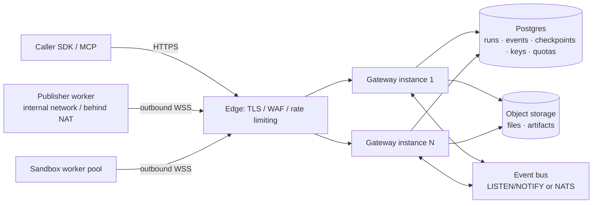

# OAA public deployment design

English · [简体中文](zh-CN/public-deployment.md)

> **Which document is this?** This one is the **design and phasing**: why OAA can be put on the public internet, what blocked it, and what each phase delivers. To actually deploy a gateway to the public internet today, follow the step-by-step runbook [deploy-public.md](deploy-public.md) (the P0 trusted-distribution configuration, reverse proxy, key distribution, workers, backup, and go-live checklist). Where the two documents overlap, the runbook is the operational authority and this design document is the rationale.

> Status: design draft (2026-11-08). This document only describes the plan; **no deployment or network change has been carried out**. Every step that involves ports, DNS, reverse proxies, certificates, or firewalls must be confirmed individually at implementation time.
>
> Code locations are those of `src/` when this document was written, in the form `file:line`. After implementation the line numbers will shift.
>
> **Progress (2026-11-08)**:
> - P0 items 1 and 2 (caller isolation, and the per-subject concurrency limit) are implemented, corresponding to schema v4, and B1–B6 and B8 are fixed. For the rules see "Caller data isolation" in `docs/protocol.md`, and for the tests `test/subject-isolation.test.ts`.
> - P0 item 4 (`consoleHosts`: console and API domains separated, the admin key usable only on the console domain) is implemented, and B15 and B16 are fixed; `/health` returns the pid only for direct local probes. For the rules see "Management plane and API domain separation" in `docs/protocol.md`, and for the tests `test/management-plane.test.ts`.
> - P0 item 3 (an environment variable allowlist for native processes) is implemented, and B10 is fixed: the worker config `nativeEnv: {mode, allow}`, where the default `inherit` keeps the original behavior; in `allowlist` mode proxy variables are passed through as is; for the tests see `test/native-env.test.ts`.
> - P0 item 5 (the deployment documentation) is done; see `docs/deploy-public.md`.
> - All of P0 is done.
> - Two P1 items are done: execution levels with enforced blocking (the key's `execution`, the gateway config `defaultKeyExecution`, the error code `isolation_required`), and audit records (`GET /v1/audit`). For the rules see "Execution levels" and "Audit records" in `docs/protocol.md`, and for the tests `test/execution-isolation.test.ts`.
> - P1 BYOK is done: the request header `X-OAA-Provider-Key`, the key exists only in gateway memory, is dispatched only to nodes that declare `byokProviders`, and never falls back to the publisher's key; the node protocol negotiates it through `byok-v1`. For the rules see "Caller-supplied model keys" in `docs/protocol.md`, and for the tests `test/byok.test.ts`.
> - Sandbox worker: S1 (the `sandbox` execution level, the srt backend, script tools running in the sandbox, the startup self-check) is implemented; the code for S2a (Claude and Codex in the sandbox) is implemented and still awaits testing with the real CLIs; S3 (gVisor) has not been done. See `docs/sandbox-design.md`.
> - The developer platform (0.4.0) is implemented: enabled by configuring the `platform` section; for the rules see `docs/platform.md`, and for the tests `test/platform-core.test.ts`, `test/platform-billing.test.ts`, `test/platform-hardening.test.ts`, `test/platform-routes.test.ts`, `test/platform-admin-routes.test.ts`, `test/platform-audit.test.ts`, `test/platform-site.test.ts`. 0.5.0 added task records and the trial console, a top-up-only key with order-number deduplication, reset codes, and startup reconciliation; for the rules see `docs/platform.md`, and for the tests `test/platform-runs.test.ts`, `test/platform-billing-key.test.ts`, `test/platform-reset.test.ts`, `test/platform-reconcile.test.ts`. Still not done: multiple publishers, payment channels, email, Postgres, and multiple instances.
> - 0.6.0 (2026-11-12): audits and fixes of protocol compatibility and the control plane, including protocol conformance, control plane robustness, and the interface system.

## 0. Summary

- **OAA is not "local only".** The listen address, TLS, reverse proxy, public base URL, and Host/Origin allowlists all have configuration options; workers connect outward over WSS, so execution nodes can sit behind NAT. "Local" is only the secure default.
- **Three things really block going public**:
  1. **Callers are not isolated from each other**: different API keys under the same owner can see each other's run records, memory, and files (§2.2). This is a P0 must-fix, regardless of whether the service is made public.
  2. **There is no execution sandbox**: native agents and host scripts inherit all the host's privileges, and native processes also receive all of the worker's environment variables (§2.2). Opening that to strangers amounts to remote code execution.
  3. **Single-instance architecture**: the single-gateway lease, SQLite, the in-process event bus, and local disk files cannot scale horizontally or fail over (§2.2).
- **The route has three phases**: P0 trusted distribution (public entry + caller isolation) → P1 public calls (sandbox + bring-your-own key + abuse prevention) → P2 platform (multiple publishers + billing + high availability). Each phase has testable acceptance criteria (§11).
- **Differentiated positioning**: OpenAI's Agent API can only execute in OpenAI's data centers. OAA's positioning is "**one public API entry, with execution landing anywhere**": platform-hosted sandboxes, the publisher's own machines, private nodes where the data lives, while keeping the existing durable approval and uncertain-write reconciliation semantics.

## 1. Goals and non-goals

**Goals**

- External developers call published agents with standard SDKs, with `base_url` set to `https://api.<domain>/v1`. OpenAI Responses/Chat, Anthropic Messages, Gemini, MCP, and `oaa/1` are supported, and all these entry points now exist.
- Publishers can choose where execution happens: a platform-hosted sandbox, or a worker node they connect themselves.
- Data is strictly isolated between callers; a publisher can see how their own agent is being called, but not content the caller has not authorized (for the exact boundary see §4.3).
- Existing semantics do not regress: durable checkpoints, approval suspension, uncertain writes that must be reconciled, and notification only after commit.

**Non-goals (outside the scope of this plan)**

- Training or hosting foundation models, or managing inference KV caches.
- A multi-master mesh. The goal of P2 is "stateless gateway instances + shared storage", not decentralized consensus.
- Sharing the subscription sign-in state on a publisher's desktop (such as a Claude/Codex account) with others (§6).

## 2. Inventory of the current state

### 2.1 Capabilities already in place

| Capability | Location | Notes |
|---|---|---|
| Listen address | `src/config/config.ts:170`, `src/gateway/server.ts:1695` | Defaults to `127.0.0.1` |
| Public base URL | `src/config/config.ts:173`, `src/gateway/server.ts:145`, `POST /v1/gateway/public-url` | Sources in order: configuration, the environment variable `OAA_PUBLIC_BASE_URL`, the runtime endpoint |
| Reverse proxy | `src/config/config.ts:174` (`trustProxy`) | Reads `X-Forwarded-Proto/Host`; the Host must still pass the allowlist |
| Host / Origin allowlists | `src/config/config.ts:176-177`, `onRequest` in `src/gateway/server.ts` | Supports `*.example.com` wildcards |
| Direct TLS | `src/config/config.ts:175` | Can also be left to the reverse proxy |
| Endpoint catalog | `GET /v1/me` → `endpoints` | Returns the SDK, Messages, Gemini, and `wss://…/v1/nodes/connect` endpoints by public address |
| Remote must be encrypted | `validateEndpoint` in `src/config/config.ts` | A non-loopback address forces HTTPS/WSS, and credentials in the URL are forbidden |
| Worker connects outward | "Node wire protocol" in `docs/protocol.md` | Bearer + node ID handshake, with leases, heartbeats, and revocation |
| Key quotas | `src/gateway/auth.ts`, `POST /v1/keys/:id/quota` | RPM, concurrency, tokens, run count, expiry |
| SSE anti-buffering | `src/gateway/streams.ts` (`x-accel-buffering: no`) | Nginx does not buffer streaming output |
| Per-owner data isolation | `src/store/store.ts` (almost every table carries `owner`) | The data foundation for multi-tenancy is already there |

### 2.2 Blockers (confirmed in the code)

> These describe the code as it stood when this document was written. The progress notes at the top list what has been fixed since: B1–B6, B8 (schema v4 subject isolation), B10, B15, and B16.

| # | Problem | Evidence | Consequence |
|---|---|---|---|
| B1 | The run list is filtered only by owner + agent authorization | `src/gateway/server.ts:1347` `store.summaries(owner, agents)` | Caller A can see caller B's runs |
| B2 | Reading a run checks only the owner | `ownedRun` in `src/gateway/server.ts` (`store.run(id, owner)`) | Knowing the ID is enough to read someone else's output, steps, and artifacts |
| B3 | Continuing a session checks only the owner | `src/kernel/kernel.ts:180` | Someone else's `previous_response_id` can be used to continue their context |
| B4 | Idempotency keys are unique per owner | `src/store/store.ts:163` `UNIQUE(owner,idem)`, `src/kernel/kernel.ts:279` | When two callers use the same idempotency key (for example `task-1`), the latecomer gets the earlier one's run |
| B5 | Memory is shared per owner | `/v1/memory` in `src/gateway/server.ts` (`getMemory(owner, ns, key)`) | Callers read and write each other's memory |
| B6 | Files are checked per owner | `src/gateway/server.ts:1192` | Knowing the file ID is enough to download files or artifacts someone else uploaded |
| B7 | A newly created key inherits its creator's owner | `create()` in `src/gateway/auth.ts` (`owner: p.owner`) | Only "one owner with a crowd of callers" is possible; a new tenant cannot be opened |
| B8 | The active run limit is counted per owner | `src/kernel/kernel.ts:287` (`>= 32`) | One caller can fill the whole owner's quota |
| B9 | RPM counting is in process memory | `src/gateway/auth.ts:30`, `:76` (default 600) | Reset on restart; not shared across instances |
| B10 | Native processes inherit all environment variables | `src/engines/native.ts:49` (only `OAA_*` is removed) | A malicious prompt can make the agent read out other secrets on the host |
| B11 | Native agents and host scripts have no OS sandbox | "Native backend boundaries" in `docs/operations.md` | Public calls amount to remote code execution |
| B12 | Single-gateway lease | `src/store/store.ts:139` (`gateway_owner`, slot=1) | Multiple instances are impossible |
| B13 | In-process event bus | `src/store/store.ts:107`, `src/fabric/network.ts:336` | SSE, waiting, and catalog notifications are valid only within this process |
| B14 | Files are stored on local disk | `src/store/store.ts:1156` | Multiple instances cannot share them |
| B15 | `/health` returns the pid | `src/gateway/server.ts:337` | Leaks process information on the public internet (a minor problem) |
| B16 | The admin console shares an origin with the API | The static asset routes in `src/gateway/server.ts` | The management plane is directly exposed to the public internet |

## 3. Deployment forms and phases

| Form | Who calls | Where it executes | Phase |
|---|---|---|---|
| A. Trusted distribution | Partners you know, your own apps | Your workers (which can include native agents) | **P0** |
| B. Public calls | Any developer who gets a key | A platform sandbox, or nodes the publisher declares publicly available | **P1** |
| C. Platform | Multiple publishers + multiple callers | Platform sandboxes + each publisher's own nodes | **P2** |

The different forms share one codebase and are distinguished by configuration and publishing metadata, without forking.

## 4. Identity and tenant model

### 4.1 Concepts

- **Tenant = the existing `owner`.** It owns agent publishing, nodes, model credential references, and admin keys. No new concept is needed, and no existing data needs to be migrated.
- **Subject = new.** It is the data owner of a call, and by default takes the API key's ID (`principal.keyId`). After P2 introduces "caller accounts", it becomes the account ID, so that multiple keys under one account can share data.
- **Owner-level admin**: a key that holds `admin` and `agents: ["*"]` can see the data of all subjects under this owner, for operations and audit.
- **Observer key** (added during implementation): a key with `admin`, or one created with `data_scope: "owner"` (for example a read-only monitoring dashboard), can see the runs and files of all subjects, but still only for the agents it is authorized for. Cross-subject access to memory is allowed only for owner-level admins.

### 4.2 Data partitioning rules

| Data | Current partition key | Changes to |
|---|---|---|
| `runs` / `run_summaries` | `owner` | `owner, subject` |
| Idempotency key | `UNIQUE(owner, idem)` | `UNIQUE(owner, subject, idem)` |
| Unique index of active sessions | `(owner, session_id)` | `(owner, subject, session_id)` |
| `previous_response_id` | Checks owner | Checks owner + subject |
| `files` | `owner` | `owner, subject`; artifacts inherit the subject of the run they belong to |
| `memories` | `(owner, namespace, key)` | `(owner, subject, namespace, key)`; read-only memory shared by the publisher uses the reserved subject `_shared` |
| `approvals` | Follows the run | Follows the run; for the approver rules see §4.3 |
| `agents` / `bundles` / nodes | `owner` | Unchanged (they belong to the publisher's assets) |

Implementation points:

- Read and write methods such as `Store.run()`, `file()`, `summaries()`, and `getMemory()` all gain a `subject` parameter. A `Scope { owner, subject | '*' }` is derived from the `principal` and passed down, instead of each route making its own judgment.
- **An owner-level admin uses `subject = '*'`**, and every other key can see only its own subject.
- Migration: the `checkpoint.keyId` of existing runs already records the key (`src/kernel/kernel.ts:338`), and `subject` is backfilled from it directly. Records without a keyId go to `legacy`, which only owner-level admins can see. The migration goes into schema v4, following the existing practice of "migrate in a transaction after obtaining the single-gateway lease, roll back on failure".

### 4.3 Cross-owner calls (P2)

In the platform form, the caller belongs to tenant B and the agent to publisher A:

- Publishing metadata gains `visibility: private | listed | public`, and an optional list of tenants allowed to call.
- The run record stores two fields: `owner` (execution ownership, which determines the bundle, nodes, and model credentials) and `subject` (`B:<account>`, which determines data visibility and billing).
- **By default publisher A sees only metadata**: run status, duration, tokens, and error code. They cannot see the caller's input, output, or files, unless the publication declares `publisher_access: content` and the caller explicitly accepts at call time.
- **Approver**: by default the caller themselves (the caller holds a key with the `approve` scope). A publisher can declare that certain tools must be approved by the publisher, for example tools that write to resources on the publisher's nodes. The existing approval persistence and suspension mechanisms need no change.

## 5. Execution isolation

### 5.1 Execution levels

An `isolation` field is added to publishing metadata and node advertisements:

| Level | Meaning | Allowed callers |
|---|---|---|
| `host` | Current state: native agents and host scripts, inheriting the host's privileges | Only the owner's own keys, or subjects explicitly marked as trusted |
| `sandbox` | One isolated environment per run (see 5.2) | All callers |

**Enforced by the scheduler**: when `network.ts` chooses candidate nodes, if the calling subject is not trusted, nodes and tools of level `host` are excluded directly. When the condition cannot be met the request is refused with `isolation_required`, and refused before the model is called. This is consistent with the existing behavior of `required: true` tools, "validate first, execute afterwards".

### 5.2 The sandbox executor

- Form: a new worker type, `sandbox-worker`. It still connects to the gateway through the same WSS node protocol, and the gateway does not need to know the implementation details of the sandbox.
- One isolated environment is started per run (or per session). Recommended order: gVisor containers (fast to start, low entry cost) → Firecracker / Kata micro-VMs (stronger isolation, for native agents).
- Default policy:
  - No network; outbound access allows only the domain allowlist declared at publication, plus the model providers' API domains.
  - CPU, memory, disk, number of processes, and the duration of a single run are limited.
  - The workspace is the existing session workspace (`workspace()` in `src/fabric/worker.ts`), destroyed by TTL after the run ends.
  - The image is mounted read-only; artifacts are sent back through the existing artifact upload channel.
- Native agents (Codex CLI, the Claude Agent SDK, and so on) are packaged into the sandbox image and run with the per-run injected API key of §6, not with the host's sign-in state.
- Update: the first backend actually implemented is srt (a process-level sandbox) rather than gVisor; gVisor is the later S3 phase. See [sandbox-design.md](sandbox-design.md).

### 5.3 Minimal fix for host mode (done in P0)

- `src/engines/native.ts:49`: environment variables change from "inherit all, remove `OAA_*`" to an **allowlist** (`PATH`, `HOME`, `LANG`, `TMPDIR`, plus the variables that engine needs and that are declared explicitly). `src/engines/process.ts` already uses `safeEnv`, and the same logic can be reused.
- When publishing an agent of level `host`, the console and the CLI must state clearly that "the caller can perform arbitrary host operations".

## 6. Model credentials and account compliance

- **Do not share subscription sign-in state.** Using a personal subscription of a desktop app or CLI to serve third parties usually violates the terms of service, and the account can be banned at any time. The public form uses API keys only.
- Credential sources (chosen at publish time):
  - **Platform key**: the platform holds the provider API key and bills callers by usage (P2, depends on billing).
  - **Publisher key**: an environment variable reference on the publisher's node. This is the existing `apiKeyEnv` mechanism and needs no change.
  - **Caller-supplied key (BYOK)**: passed at call time in a request header, for example `x-oaa-provider-key`. It exists only in memory for this run, is not written to the database, logs, or checkpoints, and is then injected into the sandbox. If a key is needed when continuing, the caller provides it again.
- Redact credentials in checkpoints, events, timelines, and error messages, and add tests confirming that credentials do not appear in SQLite or the logs.

## 7. Network entry and base URL

### 7.1 Domain plan (example)

| Domain | Purpose | Access control |
|---|---|---|
| `api.<domain>` | All call entry points, SSE, `wss://…/v1/nodes/connect` | Public; rate limiting at the edge |
| `console.<domain>` | The admin console | IP allowlist or extra single sign-on (SSO); not open to the public |

The gateway gets a new configuration, `consoleHosts`: static assets and management endpoints respond only to these Hosts, fixing B16. Accessing a console route on the API Host returns 404 directly.

### 7.2 Gateway configuration (illustrative; it will not be applied automatically)

```json
{
  "host": "127.0.0.1",
  "port": 8787,
  "publicBaseUrl": "https://api.example.com",
  "trustProxy": true,
  "allowedHosts": ["api.example.com", "console.example.com"],
  "allowedOrigins": ["https://console.example.com"]
}
```

- **The gateway itself keeps listening only on `127.0.0.1`**, exposed to the outside only by a reverse proxy on the same machine. This gives the smallest exposure surface, and no certificate needs to be configured for the Node process.
- Turn on `trustProxy: true` only when there really is a reverse proxy in front of the gateway; the reverse proxy must **overwrite** the `X-Forwarded-*` headers the client brings, and must not pass them through.

### 7.3 Reverse proxy requirements

- TLS 1.2 or later, with automatic certificate renewal.
- Support for HTTP/1.1 Upgrade (WSS node connections).
- Long-connection timeout ≥ the longest run duration. The gateway sets `requestTimeout: 0`, and SSE sends a heartbeat every 15 seconds (`src/gateway/streams.ts`).
- Request body limit ≥ 24 MiB, consistent with `bodyLimit` and the WSS `maxPayload`.
- Turn off response buffering. The gateway already sets `x-accel-buffering: no`.

Caddy example:

```caddyfile
api.example.com {
    reverse_proxy 127.0.0.1:8787 {
        flush_interval -1
        header_up X-Forwarded-Proto {scheme}
        header_up X-Forwarded-Host {host}
    }
}
```

### 7.4 The base URL contract

- The only thing a caller needs to know is `https://api.<domain>/v1`. Other endpoints come from the `endpoints` of `GET /v1/me` and should not be hard-coded.
- The gateway does not trust a Host header that has not passed allowlist validation. The existing `resolvePublicBaseUrl` already does this; when `publicBaseUrl` is configured, it is used directly.
- The MCP bridge and the CLI use the same public address (`--url https://api.example.com`); `validateEndpoint` forces HTTPS.

### 7.5 Worker connection

- A publisher's worker is configured with `gatewayUrl: "https://api.example.com"` and connects outward; **the network the worker sits in does not need to open any inbound port**.
- Node credentials are completely separate from caller keys. This is already the case: `nodeKeys` plus `POST /v1/nodes/enroll`.
- P1 adds auditing of the binding between `X-OAA-Node-ID` and the credential, and support for node credential rotation.

## 8. Abuse prevention and quotas

| Layer | Measures |
|---|---|
| Edge | Per-IP rate limiting, request body size, a basic WAF; leave DDoS to the cloud provider or a CDN |
| Gateway / key | The existing RPM, concurrency, token, and run count quotas; the default tightened from 600 RPM to a value suited to public calls |
| Gateway / subject | A new per-subject active run limit, replacing the 32 that is counted only per owner (B8); the owner total limit is kept |
| Execution | Sandbox resource limits, a maximum duration per run, a maximum number of tool-call rounds (`limits.maxTurns` already exists) |
| Audit | Authentication failures, quota refusals, isolation refusals, and node revocations are all written as audit events; the original IP is kept (passed in by the reverse proxy) |
| Public responses | `/health` drops `pid` in public mode (B15) |

In the P0 phase RPM counting can stay in memory (single instance). In P2, with multiple instances, it moves to shared storage (§9).

## 9. Horizontal scaling and high availability (P2)

The current state is limited by B12–B14. The target form:



Key design points:

- **Storage**: `Store` is abstracted into an interface; the SQLite implementation is kept for single machines and the desktop version, and a Postgres implementation is added. The semantics of "notify only after commit" stay unchanged: commit the transaction first, then send the bus message.
- **Event bus**: `store.events` and `network.events` become a local EventEmitter plus a cross-instance bus. SSE reconnection already replays from persisted events by cursor, so a lost bus message only adds latency and loses no data.
- **Node connection affinity**: a worker's WSS connection lives on one gateway instance. The scheduler delivers tasks through the bus to the instance that holds the connection; the connection table carries leases, and after an instance dies the worker reconnects to another instance.
- **Locks**: the existing in-process resource locks are replaced by lease rows with fencing tokens (Postgres row locks or advisory locks), to avoid two holders appearing after a network partition.
- **Admission queue**: moves from an in-process FIFO to a queue table in the database, dequeued with `SELECT … FOR UPDATE SKIP LOCKED`; the fair round-robin logic stays unchanged.
- **Files**: object storage plus database metadata; downloads go through gateway authentication, or use short-lived signed URLs (a signed URL must not carry long-term credentials).

## 10. Metering and billing (P2)

- A new append-only usage ledger, `usage_ledger`: for each run it records tokens (input/output/cache), the model route, tool execution time, sandbox seconds, and file traffic.
- Publishers price their agents, per call, per token, or a combination of both; the platform takes a commission.
- Prepaid balance; reserved before the run and settled afterwards. The existing key token quota stays as a hard cap.
- **Currency, payment methods, and invoices are decided by the target market; see the open decisions in §13.**

## 11. Phases and acceptance criteria

### P0: trusted distribution

Scope:

1. Caller isolation: introduce subject, fix B1–B6, the schema v4 migration.
2. A per-subject concurrency limit (B8).
3. An environment variable allowlist for native processes (B10).
4. Console and API separated by Host (B16), and `pid` removed from `/health` (B15).
5. Deployment documentation: reverse proxy, `publicBaseUrl`, backup and restore.

Acceptance (all written as automated tests, in `npm test`):

- When key A and key B belong to the same owner and are authorized for the same agent, B cannot list, read, continue, or cancel A's runs, cannot download A's files, and cannot read or write A's memory; idempotency keys of the same name are independent.
- The owner-level admin can still see all data.
- After the migration, existing data is attributed correctly by keyId; data without a keyId is visible only to admins.
- With `trustProxy` on, a forged `X-Forwarded-Host` that is not on the allowlist is rejected.
- The environment of a native process contains no undeclared variable (verified with a fixture process that prints its environment variables).
- A real remote worker connects over WSS from behind NAT and completes one run. This one is manual acceptance and needs an authorized real environment.

### P1: public calls

Scope: execution levels and scheduler-enforced isolation, the sandbox worker (gVisor), BYOK, credential redaction tests, edge rate limiting, audit events.

Acceptance:

- When an untrusted subject calls an agent of level `host`, it is refused before the model call.
- Reading host files, reaching a network outside the allowlist, and exceeding resource limits all fail inside the sandbox, and produce audit records.
- BYOK credentials do not appear in SQLite, logs, events, or error messages (a whole-database scan test).

### P2: platform

Scope: tenant registration, cross-owner publication visibility, caller accounts, billing, Postgres, object storage, the event bus, multi-instance gateways, micro-VM sandboxes.

Acceptance:

- With two gateway instances, when either one is killed, runs in progress can recover from checkpoints; after an SSE client reconnects, the output is complete and not duplicated.
- With a node connected to instance 1 and a request hitting instance 2, scheduling is still correct.
- The usage ledger reconciles entry by entry with the run records.

## 12. Positioning against the OpenAI Agent API

| | OpenAI Agent API | OAA public edition |
|---|---|---|
| Where it executes | Only in OpenAI's data centers | Platform sandboxes, publisher nodes, private nodes where the data lives |
| Models | OpenAI models | Multiple vendors; automatic route selection, cooldown, sticky sessions |
| Existing agents | Must be rewritten with its SDK | Codex, Claude, ACP, A2A, and adapters are published directly |
| Entry protocols | The OpenAI protocol | OpenAI, Anthropic, Gemini, MCP, `oaa/1` |
| Side-effect safety | Handled by the caller | Durable approval suspension, forced reconciliation of uncertain writes |
| Private deployment | Not supported | Supported (the same codebase) |

Shortcomings that must be stated honestly: no models of its own, no hosted inference and no advantage of scale, and a gap in the maturity of hosted sandboxes (such as Code Interpreter). **None of the performance advantages has been measured with real models so far** (`docs/operations.md`, "Verification"), and a comparison test with real workloads must be completed before any external promotion.

## 13. Open decisions

1. **Target market and service regions**: this directly determines compliance requirements and model choice.
   - When offering generative AI services to the public in mainland China, an ICP filing is usually required, along with generative AI service and algorithm filings; personal information protection and data export assessments are also involved.
   - By the official supported-region lists of OpenAI and Anthropic, mainland China is not among them (to be re-checked before launch). A route aimed at the mainland may need to rely mainly on domestic models.
   - The specific requirements are subject to the advice of legal counsel.
2. **The first-phase execution form**: allow only publisher-owned nodes (P0 + part of P1, low cost), or also offer platform-hosted sandboxes (which need cloud resources and operations).
3. **Cloud provider and domains**: these decide the choice of edge, WAF, object storage, and Postgres.
4. **Whether to open native agents to the public**: we recommend opening them only at the `sandbox` level plus BYOK.
5. **Billing**: currency, payment channels, whether invoices are needed.

## 14. Change list (by file)

| File | Change | Phase |
|---|---|---|
| `src/core/contracts.ts` | `Principal.subject`; add `isolation` and `visibility` to publishing metadata | P0 / P1 / P2 |
| `src/store/store.ts` | Read/write interfaces that take a `Scope`; schema v4 (subject column, indexes, migration) | P0 |
| `src/kernel/kernel.ts` | Idempotency, continuation, and active counts computed per subject; a per-subject concurrency limit | P0 |
| `src/gateway/server.ts` | Routes changed to pass in a `Scope`; `consoleHosts`; a slimmed `/health` | P0 |
| `src/gateway/auth.ts` | Generate the subject; move quotas to shared storage | P0 / P2 |
| `src/engines/native.ts` | Environment variable allowlist | P0 |
| `src/fabric/network.ts` | Filter candidate nodes by isolation level; cross-instance delivery | P1 / P2 |
| `src/fabric/worker.ts` | The `sandbox-worker` executor | P1 |
| `src/config/config.ts` | `consoleHosts`, sandbox and BYOK configuration | P0 / P1 |
| `test/` | The isolation, migration, sandbox, redaction, and multi-instance tests listed in §11 | Each phase |
