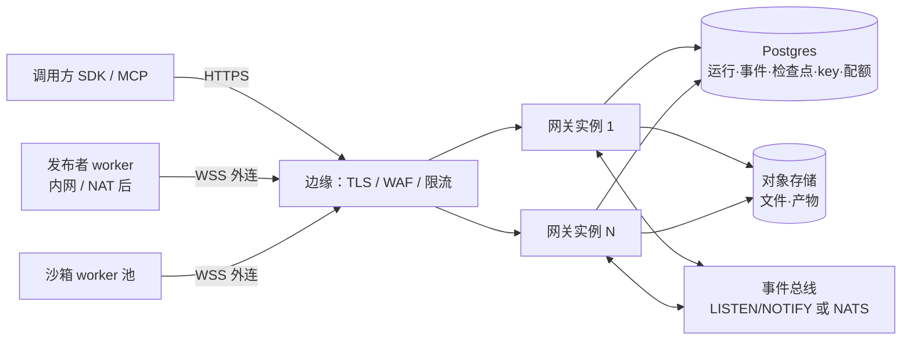

# OAA 公网化设计方案

[English](../public-deployment.md) · 简体中文

> **这是哪一份文档？** 本文是**设计与分期**：为什么 OAA 可以放到公网、之前有什么阻断、每一期交付什么。想在今天真正把网关部署到公网，请按分步手册 [deploy-public.md](deploy-public.md) 操作（P0 受信分发的配置、反向代理、密钥分发、worker、备份和上线检查清单）。两份文档有重叠的地方，以手册为操作依据，本文是背后的理由。

> 状态：设计草案（2026-11-08）。本文只描述方案，**没有执行任何部署或网络变更**。文中涉及端口、DNS、反向代理、证书、防火墙的步骤，实施时逐项单独确认。
>
> 代码位置以本文写作时的 `src/` 为准，格式为 `文件:行号`。实现之后行号会有偏移。
>
> **进度（2026-11-08）**：
> - P0 第 1、2 项（调用方隔离，以及按 subject 的并发上限）已经实现，对应 schema v4，B1–B6 和 B8 已修复。规则说明见 `docs/protocol.md`「调用方数据隔离」，测试见 `test/subject-isolation.test.ts`。
> - P0 第 4 项（`consoleHosts`：控制台与 API 域名分离，admin 密钥只能在控制台域名上使用）已经实现，B15、B16 已修复；`/health` 只对本机直接探测返回 pid。规则说明见 `docs/protocol.md`「管理面与 API 域名分离」，测试见 `test/management-plane.test.ts`。
> - P0 第 3 项（原生进程环境变量白名单）已经实现，B10 已修复：worker 配置 `nativeEnv: {mode, allow}`，默认 `inherit` 保持原有行为；`allowlist` 模式下代理变量原样传递，测试见 `test/native-env.test.ts`。
> - P0 第 5 项（部署文档）已完成，见 `docs/deploy-public.md`。
> - P0 全部完成。
> - P1 已完成两项：执行等级与强制拦截（密钥 `execution`、网关配置 `defaultKeyExecution`、错误码 `isolation_required`），以及审计记录（`GET /v1/audit`）。规则说明见 `docs/protocol.md`「执行等级」「审计记录」，测试见 `test/execution-isolation.test.ts`。
> - P1 BYOK 已完成：请求头 `X-OAA-Provider-Key`，密钥只存在网关内存里，只派给声明了 `byokProviders` 的节点，绝不回退到发布者的密钥；节点协议通过 `byok-v1` 协商。规则说明见 `docs/protocol.md`「调用方自带模型密钥」，测试见 `test/byok.test.ts`。
> - 沙箱 worker：S1（`sandbox` 执行等级、srt 后端、脚本工具在沙箱里运行、启动自检）已实现；S2a（Claude、Codex 进沙箱）的代码已实现，还待真实 CLI 实测；S3（gVisor）还没做。见 `docs/sandbox-design.md`。
> - 开发者平台（0.4.0）已实现：配置 `platform` 段后启用；规则说明见 `docs/platform.md`，测试见 `test/platform-core.test.ts`、`test/platform-billing.test.ts`、`test/platform-hardening.test.ts`、`test/platform-routes.test.ts`、`test/platform-admin-routes.test.ts`、`test/platform-audit.test.ts`、`test/platform-site.test.ts`。0.5.0 新增任务记录与试用台、充值专用密钥与单号去重、重置码、启动对账，规则见 `docs/platform.md`，测试见 `test/platform-runs.test.ts`、`test/platform-billing-key.test.ts`、`test/platform-reset.test.ts`、`test/platform-reconcile.test.ts`。仍未做：多发布者、支付渠道、邮件、Postgres 与多实例。
> - 0.6.0（2026-11-12）：协议兼容与控制面的审计与修正，包括协议合规、控制面稳健与界面体系。

## 0. 结论摘要

- **OAA 不是「只能本地」**。监听地址、TLS、反向代理、公网 base URL、Host/Origin 白名单都已有配置项；worker 主动外连 WSS，执行节点可以在 NAT 后面。「本机」只是安全默认值。
- **真正阻断公网化的是三件事**：
  1. **调用方之间不隔离**：同一 owner 下不同 API key 能互相看到运行记录、记忆和文件（§2.2）。这是 P0 必修项，与是否公开无关。
  2. **没有执行沙箱**：原生智能体和宿主脚本继承宿主机全部权限，原生进程还会拿到 worker 的全部环境变量（§2.2）。开放给陌生人等于远程代码执行。
  3. **单实例架构**：单网关租约、SQLite、进程内事件总线、本地磁盘文件，无法横向扩展和故障切换（§2.2）。
- **路线分三期**：P0 受信分发（公网入口 + 调用方隔离）→ P1 公开调用（沙箱 + 自带密钥 + 防滥用）→ P2 平台化（多发布者 + 计费 + 高可用）。每期都有可测试的验收标准（§11）。
- **差异化定位**：OpenAI 的 Agent API 只能在 OpenAI 机房里执行。OAA 的定位是「**一个公网 API 入口，执行落在任何地方**」：平台托管沙箱、发布者自己的机器、数据所在的私有节点，并且保留现有的持久审批和不确定写操作对账语义。

## 1. 目标与非目标

**目标**

- 外部开发者用标准 SDK 调用已发布的智能体，`base_url` 为 `https://api.<域名>/v1`。支持 OpenAI Responses/Chat、Anthropic Messages、Gemini、MCP、`oaa/1`，这些入口现在都已存在。
- 发布者可以选择执行位置：平台托管沙箱，或自己接入的 worker 节点。
- 调用方之间数据严格隔离；发布者能看到自己智能体的调用情况，但看不到调用方没授权的内容（具体边界见 §4.3）。
- 现有语义不退化：持久检查点、审批挂起、不确定写操作必须对账、提交后才通知。

**非目标（本方案范围外）**

- 训练或托管基础模型、管理推理 KV cache。
- 多主网格（multi-master mesh）。P2 的目标是「无状态网关多实例 + 共享存储」，不是去中心化共识。
- 把发布者桌面上的订阅登录态（如 Claude/Codex 账号）共享给他人（§6）。

## 2. 现状盘点

### 2.1 已具备的能力

| 能力 | 位置 | 说明 |
|---|---|---|
| 监听地址 | `src/config/config.ts:170`、`src/gateway/server.ts:1695` | 默认 `127.0.0.1` |
| 公网 base URL | `src/config/config.ts:173`、`src/gateway/server.ts:145`、`POST /v1/gateway/public-url` | 来源依次为配置、环境变量 `OAA_PUBLIC_BASE_URL`、运行时接口 |
| 反向代理 | `src/config/config.ts:174`（`trustProxy`） | 读取 `X-Forwarded-Proto/Host`，Host 仍需通过白名单 |
| Host / Origin 白名单 | `src/config/config.ts:176-177`、`src/gateway/server.ts` `onRequest` | 支持 `*.example.com` 通配 |
| 直接 TLS | `src/config/config.ts:175` | 也可以交给反向代理 |
| Endpoint 目录 | `GET /v1/me` → `endpoints` | 按公网地址返回 SDK、Messages、Gemini、`wss://…/v1/nodes/connect` |
| 远程必须加密 | `src/config/config.ts` `validateEndpoint` | 非 loopback 地址强制 HTTPS/WSS，URL 中禁止带凭据 |
| Worker 外连 | `docs/protocol.md`「Node wire protocol」 | Bearer + 节点 ID 握手，带租约、心跳、撤销 |
| Key 配额 | `src/gateway/auth.ts`、`POST /v1/keys/:id/quota` | RPM、并发、token、运行次数、过期时间 |
| SSE 防缓冲 | `src/gateway/streams.ts`（`x-accel-buffering: no`） | Nginx 不会缓冲流式输出 |
| Owner 维度数据隔离 | `src/store/store.ts`（几乎所有表都带 `owner`） | 多租户的数据基础已经有了 |

### 2.2 阻断项（已在代码中确认）

> 下表描述的是写作本文时的代码。顶部的进度说明列出了此后已修复的项：B1–B6、B8（schema v4 的 subject 隔离）、B10、B15、B16。

| # | 问题 | 证据 | 后果 |
|---|---|---|---|
| B1 | 运行列表只按 owner + 智能体授权过滤 | `src/gateway/server.ts:1347` `store.summaries(owner, agents)` | 调用方 A 能看到调用方 B 的运行 |
| B2 | 读取运行只校验 owner | `src/gateway/server.ts` `ownedRun`（`store.run(id, owner)`） | 知道 ID 就能读别人的输出、步骤、产物 |
| B3 | 续接会话只校验 owner | `src/kernel/kernel.ts:180` | 用别人的 `previous_response_id` 能续接别人的上下文 |
| B4 | 幂等键按 owner 唯一 | `src/store/store.ts:163` `UNIQUE(owner,idem)`、`src/kernel/kernel.ts:279` | 两个调用方用了相同的幂等键（例如 `task-1`）时，后来者会拿到前者的运行 |
| B5 | 记忆按 owner 共享 | `src/gateway/server.ts` `/v1/memory`（`getMemory(owner, ns, key)`） | 调用方之间互相读写记忆 |
| B6 | 文件按 owner 校验 | `src/gateway/server.ts:1192` | 知道文件 ID 就能下载别人上传的文件或产物 |
| B7 | 新建的 key 继承创建者的 owner | `src/gateway/auth.ts` `create()`（`owner: p.owner`） | 只能「一个 owner 带一群调用方」，无法开新租户 |
| B8 | 活跃运行上限按 owner 计数 | `src/kernel/kernel.ts:287`（`>= 32`） | 一个调用方就能占满整个 owner 的额度 |
| B9 | RPM 计数在进程内存 | `src/gateway/auth.ts:30`、`:76`（默认 600） | 重启清零；多实例时不共享 |
| B10 | 原生进程继承全部环境变量 | `src/engines/native.ts:49`（只去掉了 `OAA_*`） | 恶意提示词可以让智能体读出宿主机上的其它密钥 |
| B11 | 原生智能体和宿主脚本没有 OS 沙箱 | `docs/operations.md`「Native backend boundaries」 | 公开调用等于远程代码执行 |
| B12 | 单网关租约 | `src/store/store.ts:139`（`gateway_owner`，slot=1） | 无法多实例 |
| B13 | 进程内事件总线 | `src/store/store.ts:107`、`src/fabric/network.ts:336` | SSE、等待、目录通知只在本进程有效 |
| B14 | 文件存在本地磁盘 | `src/store/store.ts:1156` | 多实例无法共享 |
| B15 | `/health` 返回 pid | `src/gateway/server.ts:337` | 公网下泄露进程信息（问题较小） |
| B16 | 管理控制台与 API 同源 | `src/gateway/server.ts` 静态资源路由 | 管理面直接暴露在公网 |

## 3. 部署形态与分期

| 形态 | 谁在调用 | 执行在哪 | 对应分期 |
|---|---|---|---|
| A. 受信分发 | 你认识的合作方、自己的应用 | 你的 worker（可以包括原生智能体） | **P0** |
| B. 公开调用 | 任何拿到 key 的开发者 | 平台沙箱，或发布者声明为公开可用的节点 | **P1** |
| C. 平台 | 多个发布者 + 多个调用方 | 平台沙箱 + 各发布者自有节点 | **P2** |

不同形态共用一套代码，靠配置和发布元数据区分，不分叉。

## 4. 身份与租户模型

### 4.1 概念

- **租户（Tenant）= 现有的 `owner`**。它拥有智能体发布、节点、模型凭据引用和管理 key。不需要新造概念，也不需要迁移现有数据。
- **调用主体（Subject）= 新增**。它是一次调用的数据归属方，默认取值为 API key 的 ID（`principal.keyId`）。P2 引入「调用方账号」后，改为账号 ID，这样一个账号下的多把 key 可以共享数据。
- **Owner 级管理员**：持有 `admin` 且 `agents: ["*"]` 的 key，可以看到本 owner 下所有 subject 的数据，用于运维和审计。
- **观察 key**（实现时补充）：带 `admin` 的 key，或创建时指定 `data_scope: "owner"` 的 key（例如只读监控面板），可以看到所有 subject 的运行和文件，但仍只限于被授权的智能体。跨 subject 访问记忆只允许 owner 级管理员。

### 4.2 数据分区规则

| 数据 | 现在的分区键 | 改为 |
|---|---|---|
| `runs` / `run_summaries` | `owner` | `owner, subject` |
| 幂等键 | `UNIQUE(owner, idem)` | `UNIQUE(owner, subject, idem)` |
| 活跃会话唯一索引 | `(owner, session_id)` | `(owner, subject, session_id)` |
| `previous_response_id` | 校验 owner | 校验 owner + subject |
| `files` | `owner` | `owner, subject`；产物继承所属运行的 subject |
| `memories` | `(owner, namespace, key)` | `(owner, subject, namespace, key)`；发布者共享的只读记忆用保留 subject `_shared` |
| `approvals` | 跟随运行 | 跟随运行，审批人规则见 §4.3 |
| `agents` / `bundles` / 节点 | `owner` | 不变（属于发布者资产） |

实现要点：

- `Store.run()`、`file()`、`summaries()`、`getMemory()` 等读写方法统一增加 `subject` 参数。由 `principal` 推导出一个 `Scope { owner, subject | '*' }` 传下去，不在各路由里各自判断。
- **Owner 级管理员使用 `subject = '*'`**，其它 key 只能看到自己的 subject。
- 迁移：存量运行的 `checkpoint.keyId` 已经记录了 key（`src/kernel/kernel.ts:338`），直接回填 `subject`。没有 keyId 的记录归入 `legacy`，只有 owner 级管理员能看到。迁移放在 schema v4，沿用现有「拿到单网关租约后在事务内迁移、失败回滚」的做法。

### 4.3 跨 owner 调用（P2）

在平台形态下，调用方属于租户 B，智能体属于发布者 A：

- 发布元数据新增 `visibility: private | listed | public`，以及可选的允许调用租户列表。
- 运行记录保存两个字段：`owner`（执行归属，决定 bundle、节点、模型凭据）和 `subject`（`B:<账号>`，决定数据可见性和计费）。
- **默认情况下，发布者 A 只能看到元数据**：运行状态、耗时、token、错误码。看不到调用方的输入、输出和文件，除非发布声明了 `publisher_access: content`，且调用方在调用时明确接受。
- **审批人**：默认是调用方本人（调用方持有 `approve` 权限的 key）。发布者可以声明某些工具必须由发布者审批，例如会写入发布者节点上资源的工具。现有的审批持久化和挂起机制不需要改。

## 5. 执行隔离

### 5.1 执行等级

在发布元数据和节点通告里新增 `isolation` 字段：

| 等级 | 含义 | 允许的调用方 |
|---|---|---|
| `host` | 现状：原生智能体、宿主脚本，继承宿主机权限 | 只允许 owner 自己的 key，或被显式标记为受信的 subject |
| `sandbox` | 每次运行一个隔离环境（见 5.2） | 所有调用方 |

**调度器强制执行**：在 `network.ts` 选择候选节点时，如果调用主体不受信，`host` 等级的节点和工具直接排除。不满足时拒绝请求，返回 `isolation_required`，并且在调用模型之前就拒绝。这与现有 `required: true` 工具「先校验、后执行」的行为一致。

### 5.2 沙箱执行器

- 形式：一个新的 worker 类型 `sandbox-worker`。它仍然通过同一套 WSS 节点协议连接网关，网关不需要知道沙箱的实现细节。
- 每个运行（或每个会话）启动一个隔离环境。推荐顺序：gVisor 容器（启动快，起步成本低）→ Firecracker / Kata 微虚拟机（隔离更强，用于原生智能体）。
- 默认策略：
  - 没有网络；出站访问只放行发布声明的域名白名单，加上模型提供方的 API 域名。
  - 限制 CPU、内存、磁盘、进程数、单次运行时长。
  - 工作区就是现有的会话工作区（`src/fabric/worker.ts` `workspace()`），运行结束后按 TTL 销毁。
  - 只读挂载镜像；产物通过现有的产物上传通道回传。
- 原生智能体（Codex CLI、Claude Agent SDK 等）打包进沙箱镜像运行，使用 §6 的按次注入 API key，不使用宿主机登录态。
- 更新：实际先实现的后端是 srt（进程级沙箱），不是 gVisor；gVisor 留给后面的 S3 阶段。见 [sandbox-design.md](sandbox-design.md)。

### 5.3 宿主模式的最小修复（P0 就做）

- `src/engines/native.ts:49`：环境变量从「全部继承，去掉 `OAA_*`」改为**白名单**（`PATH`、`HOME`、`LANG`、`TMPDIR`，再加该引擎需要的、显式声明的变量）。`src/engines/process.ts` 已经在用 `safeEnv`，可以复用同一套逻辑。
- 发布 `host` 等级的智能体时，控制台和 CLI 要明确提示「调用方可执行任意宿主操作」。

## 6. 模型凭据与账号合规

- **不共享订阅登录态**。用桌面应用或 CLI 的个人订阅给第三方提供服务，通常违反服务条款，而且账号随时可能被封。公网形态只用 API key。
- 凭据来源（发布时选择）：
  - **平台密钥**：平台持有提供方 API key，按用量向调用方计费（P2，依赖计费）。
  - **发布者密钥**：发布者节点上的环境变量引用。这就是现有的 `apiKeyEnv` 机制，不需要改。
  - **调用方自带密钥（BYOK）**：调用时通过请求头传入，例如 `x-oaa-provider-key`。它只在本次运行的内存里存在，不落库、不进日志、不进检查点，然后注入沙箱。如果续接时需要密钥，由调用方重新提供。
- 在检查点、事件、时间线、错误信息中做凭据脱敏，并补测试：确认凭据不会出现在 SQLite 和日志里。

## 7. 网络入口与 base URL

### 7.1 域名规划（示例）

| 域名 | 用途 | 访问控制 |
|---|---|---|
| `api.<域名>` | 全部调用入口、SSE、`wss://…/v1/nodes/connect` | 公网；边缘限流 |
| `console.<域名>` | 管理控制台 | IP 白名单或额外的单点登录（SSO），不对公众开放 |

网关新增配置 `consoleHosts`：静态资源和管理接口只响应这些 Host，修复 B16。API Host 上访问控制台路由直接返回 404。

### 7.2 网关配置（示意，不会自动应用）

```json
{
  "host": "127.0.0.1",
  "port": 8787,
  "publicBaseUrl": "https://api.example.com",
  "trustProxy": true,
  "allowedHosts": ["api.example.com", "console.example.com"],
  "allowedOrigins": ["https://console.example.com"]
}
```

- **网关本身继续只监听 `127.0.0.1`**，只由同机的反向代理对外。这样暴露面最小，也不需要给 Node 进程配证书。
- `trustProxy: true` 只在网关前面确实有反向代理时开启；反向代理必须**覆盖**客户端自带的 `X-Forwarded-*` 头，不能透传。

### 7.3 反向代理要求

- TLS 1.2 及以上，证书自动续期。
- 支持 HTTP/1.1 Upgrade（WSS 节点连接）。
- 长连接超时 ≥ 运行最长时长。网关 `requestTimeout: 0`，SSE 每 15 秒发一次心跳（`src/gateway/streams.ts`）。
- 请求体上限 ≥ 24 MiB，与 `bodyLimit` 和 WSS `maxPayload` 一致。
- 关闭响应缓冲。网关已经设置了 `x-accel-buffering: no`。

Caddy 示意：

```caddyfile
api.example.com {
    reverse_proxy 127.0.0.1:8787 {
        flush_interval -1
        header_up X-Forwarded-Proto {scheme}
        header_up X-Forwarded-Host {host}
    }
}
```

### 7.4 base URL 契约

- 调用方唯一需要知道的就是 `https://api.<域名>/v1`。其它端点从 `GET /v1/me` 的 `endpoints` 获取，不要硬编码。
- 网关不信任未经白名单校验的 Host 头。现有 `resolvePublicBaseUrl` 已经这样做；配置了 `publicBaseUrl` 时直接用它。
- MCP 桥接和 CLI 使用同一个公网地址（`--url https://api.example.com`）；`validateEndpoint` 会强制 HTTPS。

### 7.5 Worker 接入

- 发布者的 worker 配置 `gatewayUrl: "https://api.example.com"`，主动外连，**worker 所在网络不需要开放任何入站端口**。
- 节点凭据与调用方 key 完全分开。这已经是现状：`nodeKeys` 加 `POST /v1/nodes/enroll`。
- P1 增加 `X-OAA-Node-ID` 与凭据的绑定审计，并支持节点凭据轮换。

## 8. 防滥用与配额

| 层 | 措施 |
|---|---|
| 边缘 | 按 IP 限流、请求体大小、基础 WAF；DDoS 交给云厂商或 CDN |
| 网关 / key | 现有 RPM、并发、token、运行次数配额；默认值从 600 RPM 收紧到适合公开调用的值 |
| 网关 / subject | 新增按 subject 的活跃运行上限，替代只按 owner 计数的 32（B8）；owner 总上限保留 |
| 执行 | 沙箱资源上限、单次运行最长时长、最多工具调用轮数（`limits.maxTurns` 已有） |
| 审计 | 鉴权失败、配额拒绝、隔离拒绝、节点撤销都写入审计事件；保存原始 IP（由反向代理传入） |
| 公网响应 | `/health` 在公网模式下去掉 `pid`（B15） |

P0 阶段 RPM 计数可以继续放在内存（单实例）。P2 多实例时迁移到共享存储（§9）。

## 9. 横向扩展与高可用（P2）

现状受 B12–B14 限制。目标形态：



关键设计：

- **存储**：`Store` 抽象出接口，保留 SQLite 实现给单机和桌面版，新增 Postgres 实现。「提交后才通知」的语义不变：先提交事务，再发总线消息。
- **事件总线**：`store.events` 和 `network.events` 改为本地 EventEmitter 加跨实例总线。SSE 断线续传本来就从持久事件按游标重放，所以总线丢消息只会增加延迟，不会丢数据。
- **节点连接亲和**：worker 的 WSS 连在某一个网关实例上。调度器把任务通过总线投递给持有该连接的实例；连接表带租约，实例宕机后 worker 会重连到其它实例。
- **锁**：现有进程内资源锁换成带 fencing token 的租约行（Postgres 行锁或 advisory lock），避免网络分区后出现两个持有者。
- **准入队列**：从进程内 FIFO 改为数据库里的队列表，用 `SELECT … FOR UPDATE SKIP LOCKED` 出队；公平轮转逻辑保持不变。
- **文件**：对象存储加数据库元数据；下载走网关鉴权，或使用短时签名 URL（签名 URL 里不能带长期凭据）。

## 10. 计量与计费（P2）

- 新增只追加的用量流水 `usage_ledger`：每个运行记录 token（输入/输出/缓存）、模型路线、工具执行时长、沙箱秒数、文件流量。
- 发布者给智能体定价，可以按次、按 token 或二者组合；平台收取抽成。
- 预付费余额；运行前预留，结束后结算。原有的 key token 配额继续作为硬上限。
- **币种、支付方式、发票由目标市场决定，见 §13 的待决策项。**

## 11. 分期与验收标准

### P0：受信分发

范围：

1. 调用方隔离：引入 subject，修复 B1–B6，schema v4 迁移。
2. 按 subject 的并发上限（B8）。
3. 原生进程环境变量白名单（B10）。
4. 控制台与 API 按 Host 分离（B16），`/health` 去掉 pid（B15）。
5. 部署文档：反向代理、`publicBaseUrl`、备份恢复。

验收（全部写成自动化测试，放在 `npm test` 里）：

- key A 和 key B 属于同一 owner、授权同一个智能体时，B 无法列出、读取、续接、取消 A 的运行，无法下载 A 的文件，无法读写 A 的记忆；同名幂等键各自独立。
- owner 级管理员仍然能看到全部数据。
- 存量数据迁移后，按 keyId 正确归属；没有 keyId 的只有管理员可见。
- `trustProxy` 开启时，伪造的 `X-Forwarded-Host` 不在白名单内会被拒绝。
- 原生进程的环境变量里不包含任何未声明的变量（用夹具进程打印环境变量来验证）。
- 一个真实的远程 worker 从 NAT 后通过 WSS 接入，完成一次运行。这一条属于人工验收，需要授权的真实环境。

### P1：公开调用

范围：执行等级与调度器强制隔离、沙箱 worker（gVisor）、BYOK、凭据脱敏测试、边缘限流、审计事件。

验收：

- 不受信 subject 调用 `host` 等级智能体时，在模型调用之前被拒绝。
- 在沙箱内读取宿主文件、访问白名单外的网络、超出资源上限，都会失败，并产生审计记录。
- BYOK 凭据不出现在 SQLite、日志、事件和错误信息中（全库扫描测试）。

### P2：平台化

范围：租户注册、跨 owner 发布可见性、调用方账号、计费、Postgres、对象存储、事件总线、多实例网关、微虚拟机沙箱。

验收：

- 两个网关实例中，任意一个被终止，进行中的运行能从检查点恢复；SSE 客户端重连后输出完整、不重复。
- 节点连在实例 1 上，请求打到实例 2，也能正确调度。
- 用量流水与运行记录逐条对账一致。

## 12. 与 OpenAI Agent API 的差异定位

| | OpenAI Agent API | OAA 公网版 |
|---|---|---|
| 执行位置 | 只在 OpenAI 机房 | 平台沙箱、发布者节点、数据所在的私有节点 |
| 模型 | OpenAI 模型 | 多厂商；按路线自动选择、冷却、粘性会话 |
| 已有智能体 | 需要按它的 SDK 重写 | Codex、Claude、ACP、A2A 和适配器直接发布 |
| 入口协议 | OpenAI 协议 | OpenAI、Anthropic、Gemini、MCP、`oaa/1` |
| 副作用安全 | 由调用方自己处理 | 持久审批挂起、不确定写操作强制对账 |
| 私有部署 | 不支持 | 支持（同一套代码） |

需要如实说明的短板：没有自有模型，没有托管推理和规模优势，托管沙箱（如 Code Interpreter）的成熟度也有差距。**所有性能优势目前都没有经过真实模型的测量**（`docs/operations.md`「Verification」），对外宣传前必须先完成真实负载的对照测试。

## 13. 待决策项

1. **目标市场和服务地区**：直接决定合规要求和模型选择。
   - 如果面向中国大陆公众提供生成式 AI 服务，通常需要 ICP 备案，以及生成式人工智能服务和算法相关备案；还涉及个人信息保护和数据出境评估。
   - 按 OpenAI、Anthropic 官方的支持地区列表，中国大陆不在其中（上线前需要再核对）。面向大陆的路线可能需要以国内模型为主。
   - 具体要求以法律顾问意见为准。
2. **首期执行形态**：只允许发布者自有节点（P0 + 部分 P1，成本低），还是同时提供平台托管沙箱（需要云资源和运维）。
3. **云厂商和域名**：决定边缘、WAF、对象存储、Postgres 的选型。
4. **原生智能体是否对公众开放**：建议只允许以 `sandbox` 等级加 BYOK 的方式开放。
5. **计费**：币种、支付渠道、是否需要发票。

## 14. 变更清单（按文件）

| 文件 | 变更 | 分期 |
|---|---|---|
| `src/core/contracts.ts` | `Principal.subject`；发布元数据加 `isolation`、`visibility` | P0 / P1 / P2 |
| `src/store/store.ts` | 以 `Scope` 为参数的读写接口；schema v4（subject 列、索引、迁移） | P0 |
| `src/kernel/kernel.ts` | 幂等、续接、活跃数按 subject 计算；按 subject 的并发上限 | P0 |
| `src/gateway/server.ts` | 各路由改为传入 `Scope`；`consoleHosts`；`/health` 精简 | P0 |
| `src/gateway/auth.ts` | 生成 subject；配额迁移到共享存储 | P0 / P2 |
| `src/engines/native.ts` | 环境变量白名单 | P0 |
| `src/fabric/network.ts` | 按隔离等级过滤候选节点；跨实例投递 | P1 / P2 |
| `src/fabric/worker.ts` | `sandbox-worker` 执行器 | P1 |
| `src/config/config.ts` | `consoleHosts`、沙箱和 BYOK 配置 | P0 / P1 |
| `test/` | §11 列出的隔离、迁移、沙箱、脱敏、多实例测试 | 各期 |
