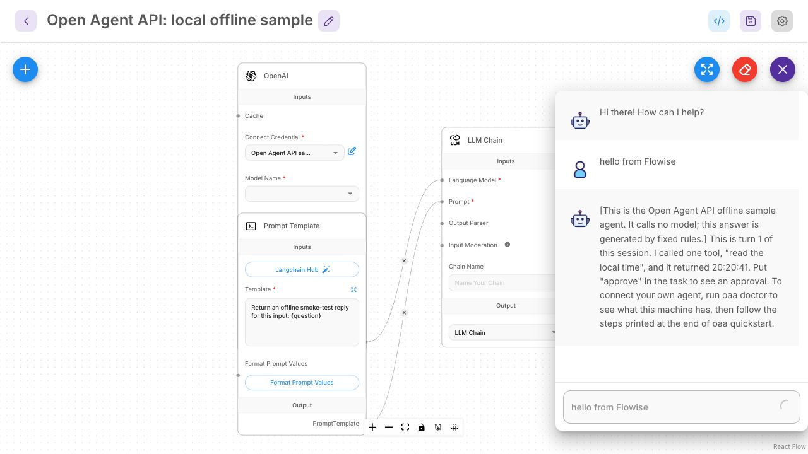

# Run a local Open Agent API sample from Flowise

> For people with an existing, isolated Flowise installation. [Upstream Flowise is archived](https://flowiseai.com/sunset)
> and no longer receives official fixes. This example is not a recommendation
> to deploy the archived release, especially not on a network-facing host.
> Community forks were not tested.

This community example connects the built-in OpenAI node in a self-hosted
Flowise Chatflow to the OpenAI-compatible route of a local Open Agent API
gateway. It uses Flowise's standard Prompt Template and LLM Chain nodes. The
`agent/sample` backend is deterministic and needs no online model or provider
key.

1. Install [Open Agent API](https://github.com/jiangxingfan1-coder/Open-Agent-API/releases/tag/v0.0.64)
   and run `oaa quickstart`. Use the gateway base URL ending in `/v1` and
   the caller key from the path printed by quickstart. Do not use the gateway
   admin key.
2. Create a Chatflow in your local [Flowise](https://docs.flowiseai.com/getting-started)
   instance and load [the Chatflow JSON](open-agent-api-offline-chatflow.json).
   Keep `agent/sample` as the model name. The Base Path defaults to
   `http://127.0.0.1:8787/v1`; change it to your loopback port if necessary.
   Here, Flowise and the gateway are running directly on the same machine.
   In Flowise 3.1.4 the dropdown can look blank for a model that is not in
   the OpenAI preset list. The imported `modelName` is already set; do not
   replace it with an OpenAI preset.
3. Create a local **OpenAI API** credential in Flowise's OpenAI node and
   use the Open Agent API caller key as its value. No credential is included
   in the export. Save the flow and send `hello from Flowise` in the test chat.
4. For calls to Flowise over HTTP, [assign a separate API key to the Chatflow](https://docs.flowiseai.com/configuration/authorization/chatflow-level).
   That key is for Flowise; the gateway caller key stays in Flowise's credential
   store. Do not publicly expose the demo servers.

```sh
curl -NsS --fail-with-body "${FLOWISE_ORIGIN}/api/v1/prediction/${FLOW_ID}" \
  -H "Authorization: Bearer ${FLOWISE_PREDICTION_KEY}" \
  -H 'Content-Type: application/json' \
  -d '{"question":"hello from Flowise","streaming":true}'
```

The response should identify itself as the **Open Agent API offline sample
agent**. This workflow does not install an agent, acquire external credentials,
or approve calls. Use only an endpoint approved by the Flowise administrator.

Verified with Flowise 3.1.4 and Open Agent API 0.0.64. The UI chat, authenticated
JSON prediction, and authenticated streamed prediction each returned the
offline response. An unauthenticated prediction was refused and did not
create a gateway run. The verification key for the gateway was scoped to
`invoke` on `agent/sample`.


